# Streezy user guide

Streezy is a free live-streaming app for Windows. Underneath is OBS Studio's video engine, so capture and encoding are the same code OBS uses. What's different is everything around it: a simpler window, a setup that builds your scenes for you, and multistreaming, alerts, chat, overlays, game themes and a phone remote that work without plugins.

This guide is for Streezy 2.0. It takes you from nothing to your first stream, then explains every part of the app. If you have never streamed before, read **Part 1** and **Part 3** first. The rest is there when you need it.

In the pictures, **blue numbered boxes** show what to click. The numbers match the steps under each picture. Everything shown is demo content: the game, webcam, chat and channel names are made up.

> **Coming from Streezy 1.x?** The window has five pages along the top now, and the older pages live inside them. [Section 4](#4-a-tour-of-the-window) has a table of where everything went.

## Contents

**Part 1. Get started**
1. [What you need](#1-what-you-need)
2. [Install Streezy](#2-install-streezy)
3. [The first-run setup](#3-the-first-run-setup)
4. [A tour of the window](#4-a-tour-of-the-window)

**Part 2. Build what viewers see**
5. [Scenes](#5-scenes)
6. [Sources: your game, camera, screen and more](#6-sources-your-game-camera-screen-and-more)
7. [Arrange things in the preview](#7-arrange-things-in-the-preview)
8. [Sound: your mic and PC sound](#8-sound-your-mic-and-pc-sound)
9. [Overlays](#9-overlays)
10. [Game themes](#10-game-themes)
11. [Style: 25 looks](#11-style-25-looks)
12. [Your details](#12-your-details)
13. [Alerts](#13-alerts)
14. [On stream now: poll, timer, pinned message](#14-on-stream-now-poll-timer-pinned-message)
15. [Your own HTML overlays](#15-your-own-html-overlays)
16. [Chat](#16-chat)

**Part 3. Go live**
17. [Add where you stream](#17-add-where-you-stream)
18. [Pick your quality](#18-pick-your-quality)
19. [Go live](#19-go-live)
20. [While you are live](#20-while-you-are-live)
21. [End the stream](#21-end-the-stream)

**Part 4. Widescreen and vertical**
22. [Stream vertical for Shorts, TikTok and Reels](#22-stream-vertical-for-shorts-tiktok-and-reels)

**Part 5. More tools**
23. [Recording and clips](#23-recording-and-clips)
24. [Stream reports](#24-stream-reports)
25. [Automatic scene changes](#25-automatic-scene-changes)
26. [The phone remote](#26-the-phone-remote)
27. [Stream Deck and OBS tools](#27-stream-deck-and-obs-tools)
28. [Plugins](#28-plugins)
29. [Scene collections and moving from OBS](#29-scene-collections-and-moving-from-obs)
30. [Hotkeys](#30-hotkeys)
31. [Command palette, mini mode, full screen and virtual camera](#31-command-palette-mini-mode-full-screen-and-virtual-camera)
32. [Other settings](#32-other-settings)

**Part 6. Help**
33. [The stream doctor](#33-the-stream-doctor)
34. [If something goes wrong](#34-if-something-goes-wrong)
35. [Updating and uninstalling](#35-updating-and-uninstalling)
36. [Privacy and where your files are](#36-privacy-and-where-your-files-are)
37. [Words you will see](#37-words-you-will-see)
38. [Get help](#38-get-help)

---

# Part 1. Get started

## 1. What you need

- **A Windows PC:** Windows 10 (version 1809 or newer) or Windows 11, 64-bit. There's no Mac or Linux version.
- **A graphics card is recommended.** Streezy uses NVIDIA, AMD or Intel graphics to encode your stream, which leaves your processor free for games. Without one it still works, using the processor.
- **Internet upload speed.** Each platform needs about 2.5 to 12 Mbps of *upload*, depending on quality. Streezy measures yours during setup and picks a quality that fits.
- **An account on the platform you want to stream to**, such as Twitch, YouTube, Kick, Facebook, TikTok or X. Streezy itself needs no account.
- **Optional:** a webcam and a microphone. A headset mic is fine.
- **Optional:** a phone on the same Wi-Fi, to use as a remote. Nothing to install on it.

## 2. Install Streezy

1. Download **StreezySetup.exe** from [zylio.net/software/streezy](https://zylio.net/software/streezy) or from the [releases page](https://github.com/faisalrasheed442/streezy-releases/releases/latest). It is one file; everything Streezy needs is inside it.
2. Open the file. Windows asks for permission to install, because Streezy also installs its virtual camera. Click **Yes**.
3. If Windows shows **"Windows protected your PC"**, click **More info**, then **Run anyway**. Streezy's installer isn't code-signed yet, and SmartScreen warns about unsigned apps until enough people have run them.
4. Follow the installer. You can tick **Create a desktop shortcut**.
5. On the last page, leave **Launch Streezy** ticked and click **Finish**.

Streezy starts with a small window saying *Starting the video engine…*, then opens the setup.

> Streezy installs to `C:\Program Files\Streezy`. Your own settings and scenes are kept separately in `%APPDATA%\Streezy`, and recordings go to `%USERPROFILE%\Videos\Streezy`. Updating from 1.x keeps all of them.

## 3. The first-run setup

The first time Streezy opens, a short setup asks nine questions and builds your scenes, overlays, alerts and mic for you. It takes about two minutes. **You can change every answer later.**

### Step 1: Welcome

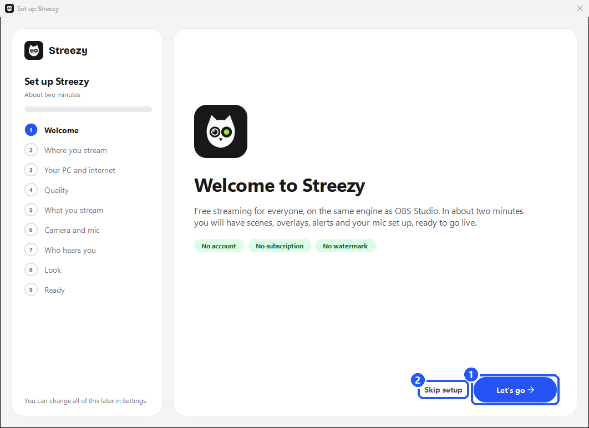

1. Click **Let's go** to start.
2. Or click **Skip setup** to go straight to the Stream page. Streezy then builds the standard *Games* scenes for you. Every choice in the setup can be made later in the app.

### Step 2: Where you stream

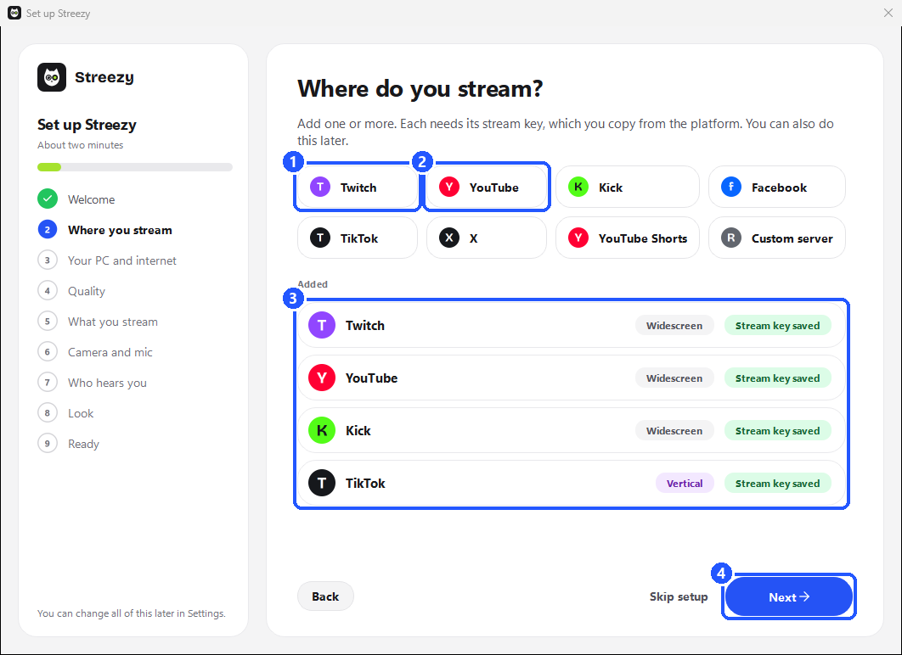

1. Click the platform you stream to, here **Twitch**. A small window opens asking for that platform's stream key (see [section 17](#17-add-where-you-stream) for where to find it).
2. Add as many platforms as you like: **YouTube**, Kick, Facebook, TikTok, X, YouTube Shorts or a custom server.
3. Everything you add appears under **Added**, with whether it is widescreen or vertical and whether its key is saved.
4. Click **Next**.

You can skip this step and add platforms later in **Settings > Where you stream**. Without any, you can still record.

### Step 3: Your PC and internet

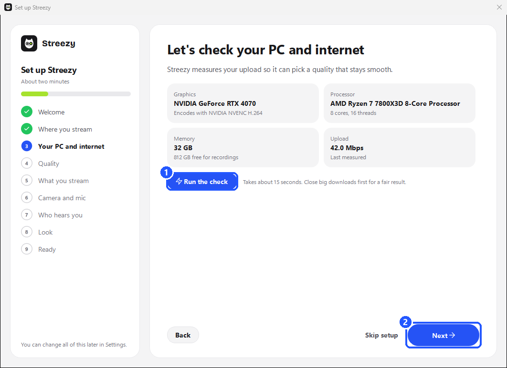

1. Click **Run the check**. Streezy looks at your graphics card, processor and memory, and tests your upload speed. It takes about 15 seconds. Pause big downloads first for a fair result.
2. Click **Next**.

### Step 4: Quality

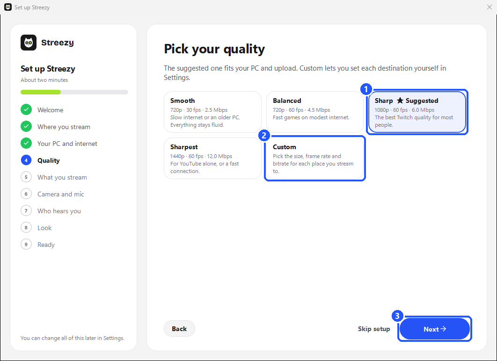

1. Streezy marks the preset that suits your PC and upload with **★ Suggested**. Most people should keep it.
2. **Custom** lets you set size, frame rate and bitrate for each platform yourself, later in Settings.
3. Click **Next**.

| Preset | Picture | Upload per platform | Good for |
|---|---|---|---|
| **Smooth** | 720p, 30 fps | 2.5 Mbps | Slow internet or an older PC |
| **Balanced** | 720p, 60 fps | 4.5 Mbps | Fast games on modest internet |
| **Sharp** | 1080p, 60 fps | 6 Mbps | The best Twitch quality for most people |
| **Sharpest** | 1440p, 60 fps | 12 Mbps | YouTube alone, or a fast connection |

### Step 5: What you stream

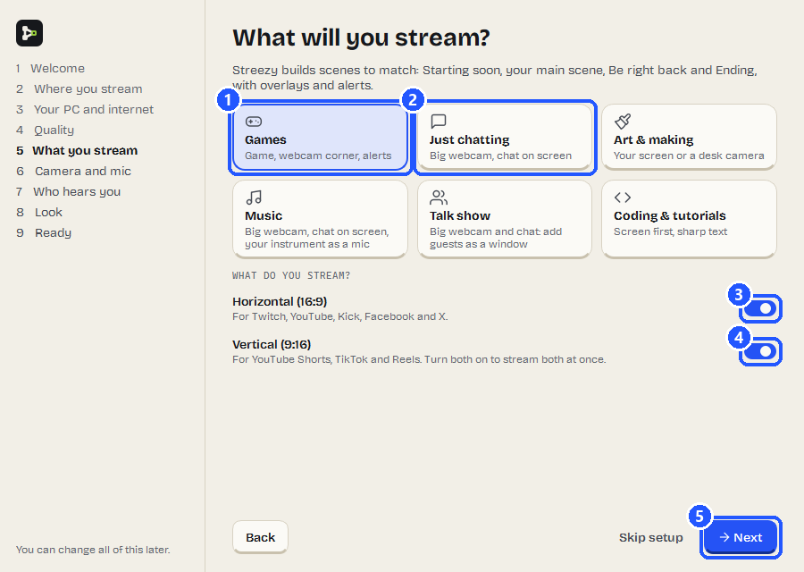

1. Pick the card that fits, for example **Games**: your game full screen, your webcam in a corner, and alerts.
2. Or **Just chatting** for a big webcam with chat on screen. There are also cards for art and making, music, talk shows, and coding or tutorials.
3. **Widescreen (16:9)** is the normal picture for Twitch, YouTube, Kick, Facebook and X.
4. **Vertical (9:16)** is the upright phone picture for YouTube Shorts, TikTok and Reels.

   Turn on either one or both (see [Part 4](#part-4-widescreen-and-vertical)). One always stays on: if you turn off the last one, the other switches on.
5. Click **Next**.

Whichever card you pick, you get these scenes: **Starting soon**, your main scene, **Be right back** and **Ending**. Each is filled with overlays that follow your name and colour.

### Step 6: Your camera and mic

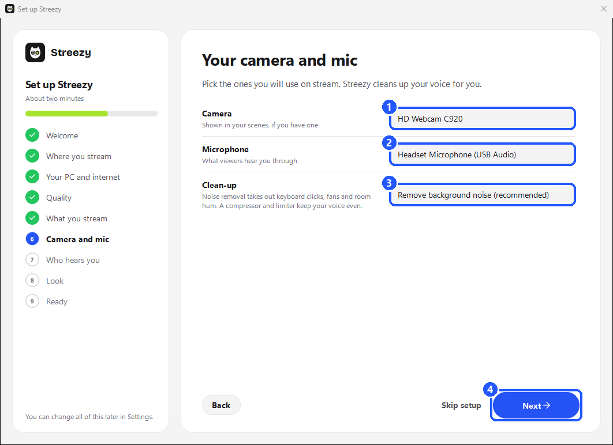

1. **Camera:** pick your webcam, or **No camera**.
2. **Microphone:** pick your mic.
3. **Clean-up:** keep **Remove background noise (recommended)**. It takes out keyboard clicks, fans and room hum, and keeps your voice at an even level. With an NVIDIA RTX card you can choose **NVIDIA noise removal** instead.
4. Click **Next**.

### Step 7: Who hears your mic

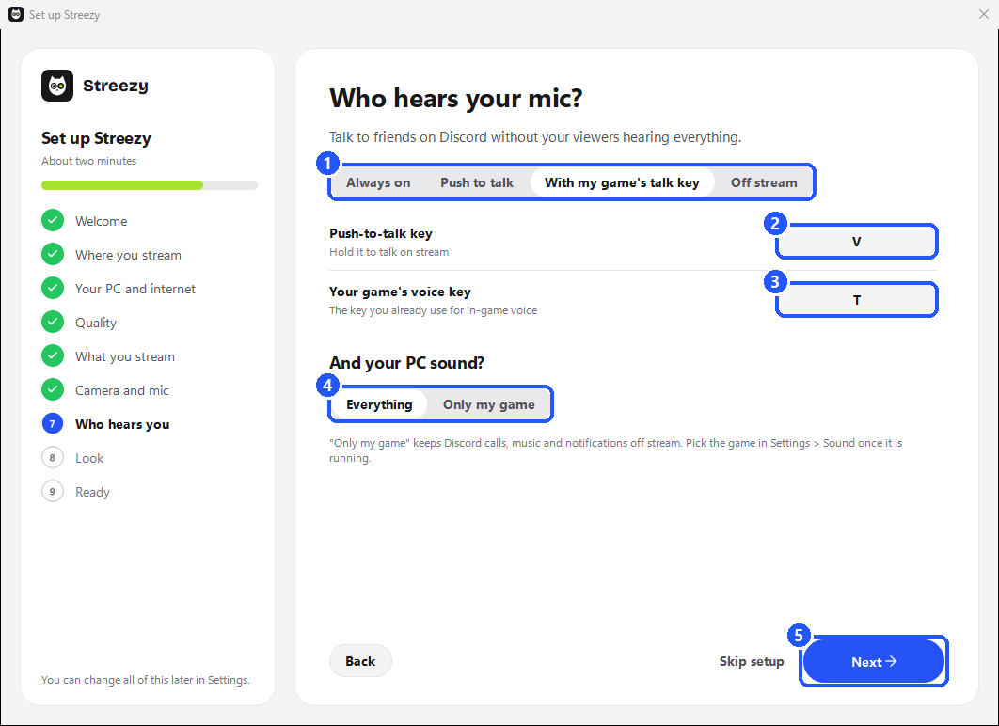

This is the step that keeps your Discord or party chat off stream. Viewers hearing a private call is one of the most common first-stream mistakes, and it's easy to miss, because you never hear your own stream.

1. Choose when viewers hear your mic:
   - **Always on:** viewers hear you all the time.
   - **Push to talk:** viewers hear you only while you hold a key.
   - **With my game's talk key:** your mic goes on stream when you press the key you already use for in-game voice. You can talk to Discord freely the rest of the time.
   - **Off stream:** viewers never hear your mic.
2. **Push-to-talk key:** click the box and press the key you want (default **V**).
3. **Your game's voice key:** click the box and press your game's voice key (default **T**).
4. **And your PC sound?** **Everything** sends all PC sound to the stream. **Only my game** sends just your game, so Discord calls, music and notifications stay off stream. You pick the game later in **Settings > Sound**, once it is running.
5. Click **Next**.

### Step 8: Look

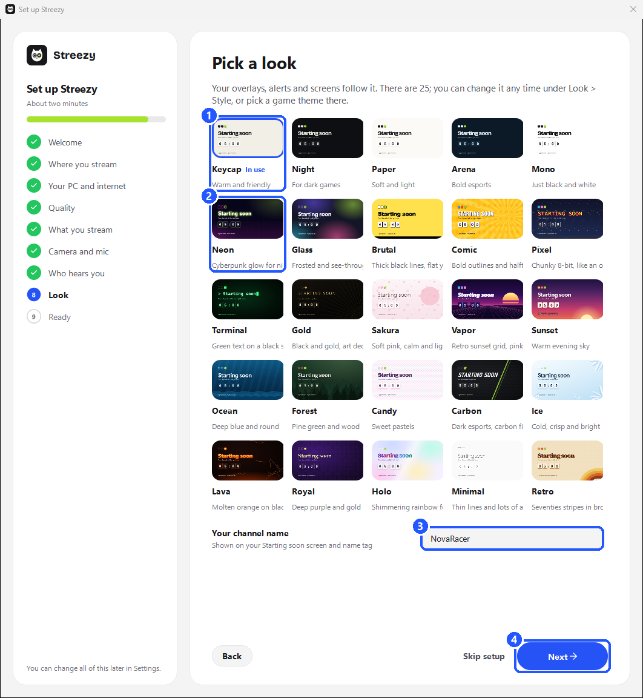

Streezy's overlays come in 25 looks. Each picture shows that look's *Starting soon* screen.

1. **Keycap**, warm paper keys with a lime glow, is the Streezy look. **In use** marks the one picked.
2. Click any other, for example **Neon**, cyberpunk glow for night streams. The rest are Night, Paper, Arena, Mono, Glass, Brutal, Comic, Pixel, Terminal, Gold, Sakura, Vapor, Sunset, Ocean, Forest, Candy, Carbon, Ice, Lava, Royal, Holo, Minimal and Retro.
3. Type **your channel name**. It appears on your Starting soon screen and your name tag.
4. Click **Next**.

You can change the look any time in **Look > Style**, or dress your scenes with a game theme in **Look > Game themes** ([section 10](#10-game-themes)).

### Step 9: Ready

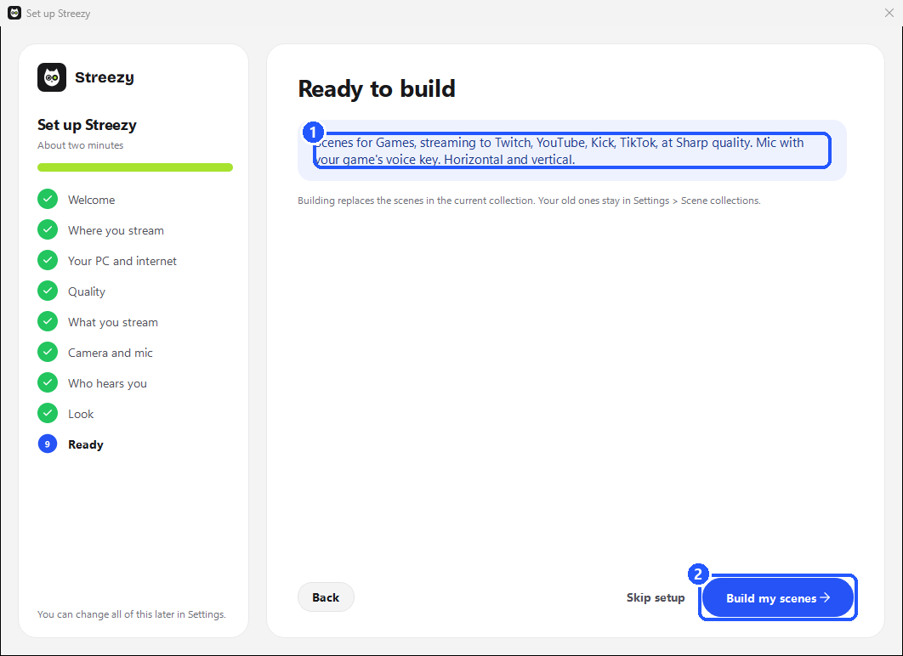

1. Check the summary.
2. Click **Build my scenes**. A few seconds later the Stream page opens with everything in place.

## 4. A tour of the window

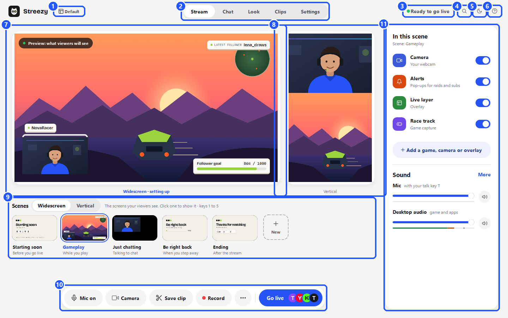

The top bar is always there:

1. **Scene collection.** It shows your current set of scenes. Click it to switch to another set (see [section 29](#29-scene-collections-and-moving-from-obs)).
2. **The five pages:** **Stream** (where you go live), **Chat**, **Look** (overlays, game themes, alerts), **Clips** (clips, recordings and reports) and **Settings**.
3. **The status pill.** It says **Ready to go live**, or **Live on 4** while you stream to four platforms. If something is wrong it names it, for example "Kick: reconnecting". Hover over it for processor use, frames per second, upload and free disk space; click it to open the [stream doctor](#33-the-stream-doctor).
4. **Search** opens the command palette (**Ctrl+K**, [section 31](#31-command-palette-mini-mode-full-screen-and-virtual-camera)).
5. **Light or dark.**
6. **Help** opens the stream doctor.

Below it is the **Stream** page:

7. **The widescreen preview.** This is exactly what your viewers see. The caption under it says **Widescreen · setting up** when the scenes and sources below are the widescreen ones.
8. **The vertical preview**, only if you turned vertical on. Both previews are the same height, side by side. Click a caption to set up that one.
9. **Scenes:** the screens your viewers see. Click one to put it on air.
10. **The dock:** mic, camera, clip, record, more, and **Go live**.
11. **In this scene:** everything in the scene on air, and the sound. While you are live, chat takes this place.

### Where the 1.x pages went

Streezy 1.x had a rail of pages on the left. In 2.0 each one lives inside one of the five pages at the top:

| In 1.x | In 2.0 |
|---|---|
| Studio | **Stream** |
| Alerts | **Look > Alerts** |
| Overlays | **Look > Overlays**, **Look > Style**, **Look > Your details** and **Look > Your own overlays** |
| Audio | **Settings > Sound** (quick sliders are on the Stream page, under **In this scene**) |
| Clips | **Clips > Clips** and **Clips > Recordings** |
| Reports | **Clips > Reports** |
| Accounts | **Settings > Where you stream** |
| Automate | **Settings > Automatic scene changes** |
| Remote | **Settings > Phone remote** |
| Plugins | **Settings > Plugins** |
| Settings > Video | **Settings > What you stream** |
| Easy / Studio switch | Gone. There is one mode: clicking a scene puts it on air. |
| Toolbar above the preview | **The dock** at the bottom of the Stream page |
| Status bar at the bottom | **The status pill** in the top bar |

New in 2.0: **game themes**, **25 looks**, the **On stream now** controls, and the phone remote rebuilt as a **deck** of keys.

---

# Part 2. Build what viewers see

## 5. Scenes

A **scene** is one screen layout. Typical scenes are *Starting soon*, *Gameplay*, *Just chatting*, *Be right back* and *Ending*. You switch between them while live, and viewers see the change straight away.

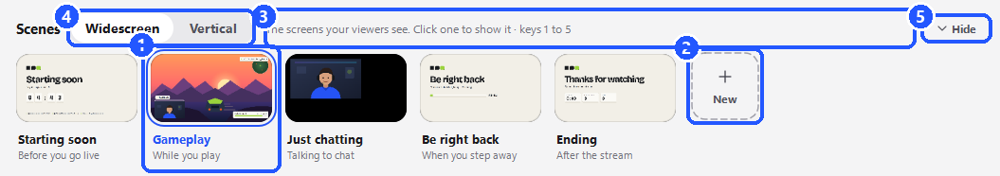

1. **A scene card** shows a live picture of the scene, its name and what it is for: *Before you go live*, *While you play*, *Talking to chat*, *When you step away*, *After the stream*, or *Your own scene* for one you made. **Click a card** to put that scene on air. Hover over it for a longer explanation. **Double-click** to rename it, and **drag** cards to reorder them.
2. **New** adds a scene. Type a name and press Enter.
3. The line next to **Scenes** reminds you that the keys **1** to **9** switch scenes while Streezy is in front.
4. **Widescreen / Vertical** chooses whose scenes you are looking at. It only appears when vertical is on (see [Part 4](#part-4-widescreen-and-vertical)).

**Right-click a scene card** (or press its **⋯**) for more:

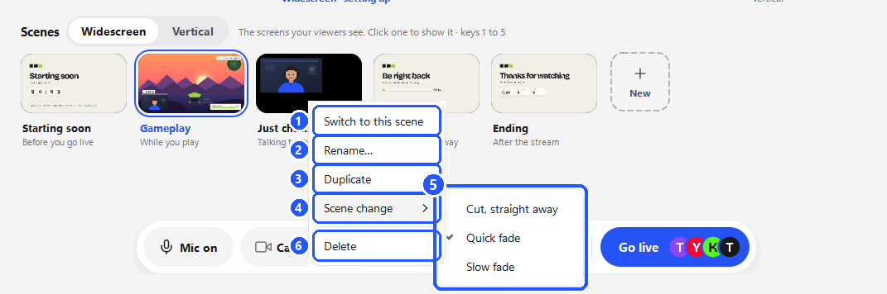

1. **Switch to this scene.**
2. **Rename…**
3. **Duplicate:** a copy to change without touching the original.
4. **Scene change** decides how one scene turns into the next…
5. …**Cut, straight away**, **Quick fade** or **Slow fade**. It applies to every scene change.
6. **Delete** removes the scene. Sources used only in that scene are removed too.

> Tip: **Ctrl+Shift+B** jumps straight to your *Be right back* scene, even while your game is in front.

## 6. Sources: your game, camera, screen and more

A **source** is anything inside a scene: your game, webcam, a picture, an overlay, some text. The panel on the right of the Stream page, **In this scene**, lists them.

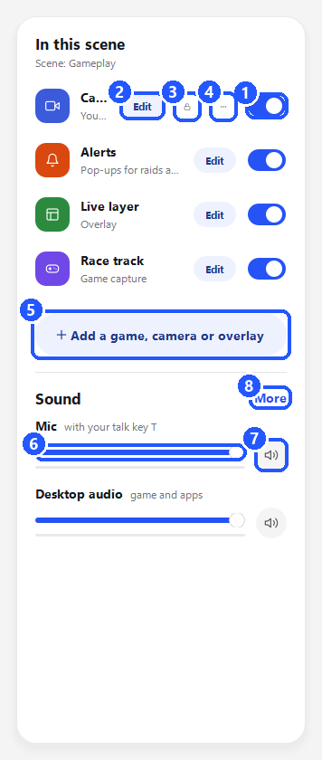

1. **The switch** shows or hides a source. Items higher in the list are drawn on top.
2. Hover over a row for the **padlock**, which locks it in place…
3. …and **⋯**, the same menu you get by right-clicking it (see [section 7](#7-arrange-things-in-the-preview)).
4. **Add a game, camera or overlay** puts something new into the scene.
5. Under **Sound**, a **slider** for your mic, your PC sound and any apps you added…
6. …with a **mute** button each. The line next to **Mic** says when viewers hear it, for example *with your talk key T*.
7. **More** opens **Settings > Sound**. That is also where the sound of overlays and web pages is.

Double-click a source to open its settings.

### Adding a source

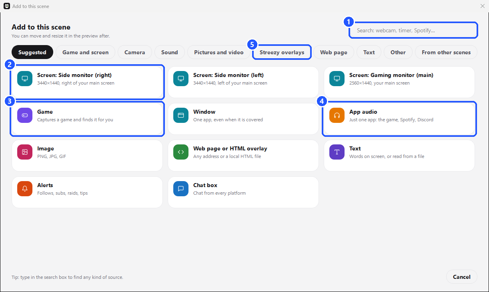

1. **Search** for any kind of source, for example "webcam", "timer" or "Spotify".
2. **Screen** tiles: Streezy lists each of your monitors by name and position (main, left, right). Pick the one to show.
3. **Game** captures a game and finds it by itself. Start your game, and the source shows it.
4. **App audio** adds the sound of just one app: the game, Spotify or Discord.
5. The tabs along the top hold everything else. **Streezy overlays** has the built-in overlays from [section 9](#9-overlays).

| Tab | What it adds |
|---|---|
| **Suggested** | Your screens, the game, a window, app audio and the overlays most people want |
| **Game and screen** | **Game**, **Window** (one app, even when it is covered), **Screen** (one monitor) |
| **Camera** | Your webcams by name, or **Webcam or capture card** for consoles and camcorders |
| **Sound** | **Microphone**, **App audio**, **Desktop audio** (everything your PC plays) |
| **Pictures and video** | **Image**, **Video or sound file**, **Slideshow**, **VLC playlist** |
| **Streezy overlays** | Alerts, chat box, goal bar, name tag, screens and the other built-in overlays |
| **Web page** | **Web page or HTML overlay** (any web address or a local HTML file) |
| **Text** | **Text**: words on screen, or read from a file |
| **Other** | **Colour**: a plain colour block, and sources from plugins |
| **From other scenes** | Your other scenes (to put a whole scene inside this one), and sources you already have |

After you pick a source, its settings open so you can choose, for example, which window to capture.

Streezy also helps with a few common situations:
- **A second Game source** reuses the game capture you already have, so it shows your game straight away.
- **Your first microphone** becomes your stream mic, so push-to-talk, clean-up and the mute key work on it.
- **Adding App audio when PC sound is set to Everything** shows a warning, because that app would be heard twice.
- **A screen capture with no monitor picked** shows your main screen.

### Source settings

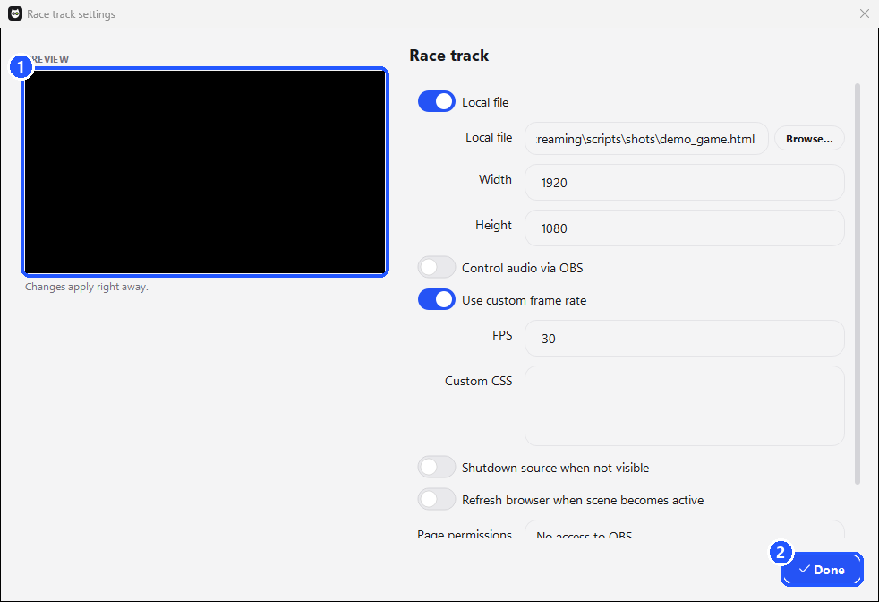

1. The **preview** on the left shows the result as you change things. *Changes apply right away.*
2. Click **Done** when you are finished.

### Filters

Filters change how a source looks or sounds. Right-click a source and choose **Audio filters…** or **Filters (picture)…**.

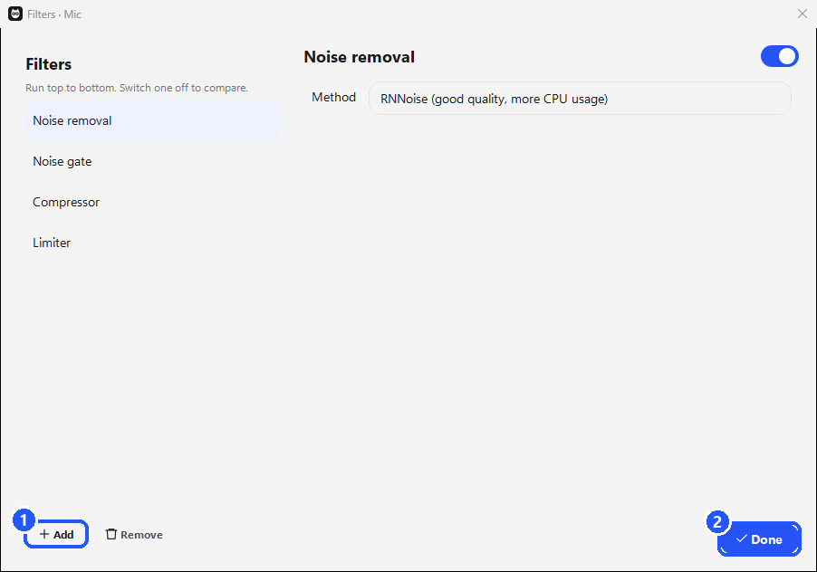

1. **Add** a filter. Filters run from top to bottom. Switch one off to compare.
2. Click **Done**.

| For sound | For picture |
|---|---|
| Noise removal, Noise gate, Compressor, Limiter, Gain, 3-band EQ, Expander, Upward compressor | Crop, Colour correction, Green screen (chroma key), Colour key, Image mask, Sharpen, Scroll, Look-up table (LUT), Background removal (NVIDIA RTX), Luma key, Delay |

> Your mic already has noise removal, a noise gate, a compressor and a limiter from setup. You usually don't need to add anything.

## 7. Arrange things in the preview

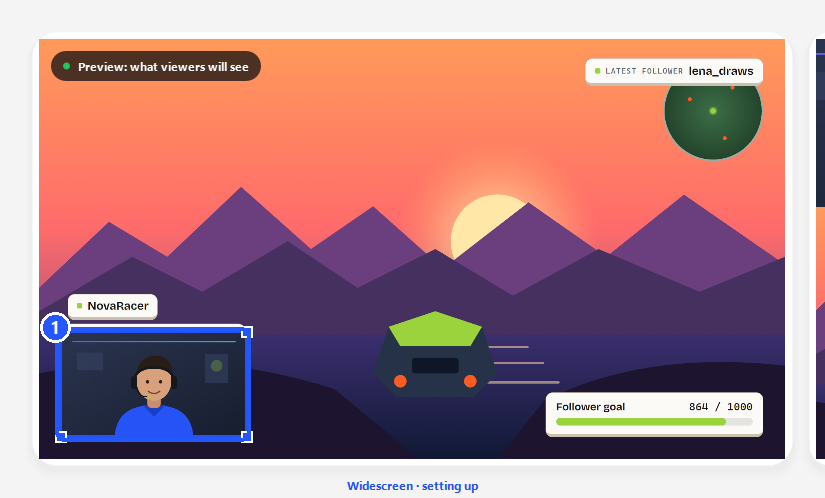

1. **Click** an item in the preview to select it. A box with corner handles appears around it, and the same row lights up under **In this scene**.

Then:
- **Drag** to move it. It snaps to the edges and centre of the screen, and a guide line shows when it does. Hold **Shift** to move freely.
- **Drag a corner** to resize it. It keeps its shape; hold **Ctrl** to stretch it.
- **Arrow keys** nudge it by 1 pixel, or by 10 pixels with **Shift**. Click the preview first.
- **Delete** removes it from the scene (Streezy asks first).
- **Double-click** opens its settings.
- **Right-click** it, in the preview or in the list, for everything else:

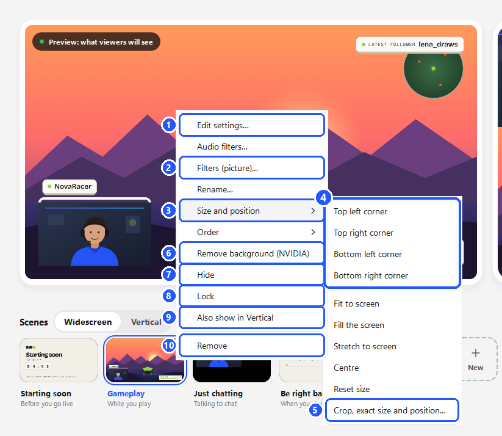

1. **Settings…**
2. **Filters (picture)…** (and **Audio filters…** for anything with sound).
3. **Size and position** opens a list…
4. …that starts with the four corners: **Top left corner**, **Top right corner**, **Bottom left corner** and **Bottom right corner** move it there with a small margin. Below them are **Fit to screen**, **Fill the screen**, **Stretch to screen**, **Centre** and **Reset size**.
5. **Crop, exact size and position…** lets you type exact numbers and cut off the edges.
6. **Remove background (NVIDIA)** appears for webcams on PCs with an NVIDIA RTX card. Tick it and your room disappears behind you; untick it to bring it back.
7. **Hide** keeps it in the scene without showing it.
8. **Lock** stops it from being moved or resized by accident.
9. **Also show in Vertical** copies it onto your vertical canvas (see [Part 4](#part-4-widescreen-and-vertical)).
10. **Remove** takes it out of this scene.

The menu also has **Rename…**, **Order** (bring to front, move up, move down, send to back) and, for web pages, **Reload page**. Right-clicking an empty part of the preview offers **Add a source…** and full screen on a monitor.

> **Black parts in the preview?** The preview shows the empty parts of a scene as black, exactly as viewers see them. Fill them with **Fit to screen** or **Fill the screen**, or add a picture or colour behind.

## 8. Sound: your mic and PC sound

The quick sliders are on the Stream page under **In this scene**. Everything else is in **Settings > Sound** (press **More** next to *Sound*, or **⋯ > Who hears what…** in the dock).

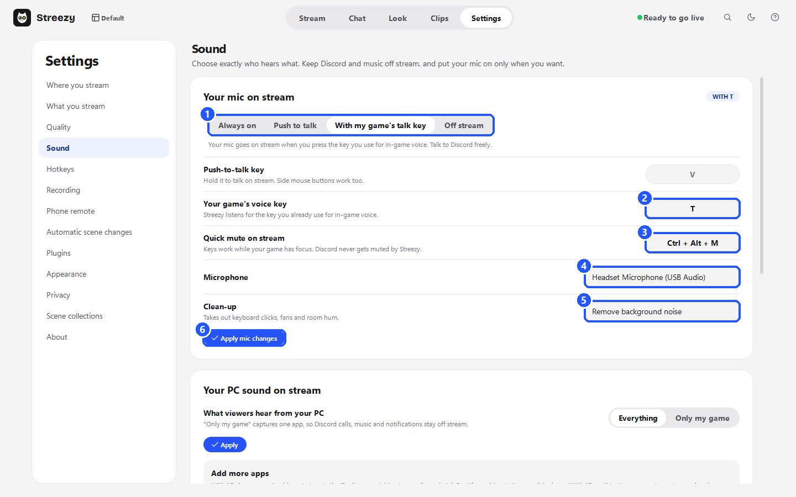

**Your mic on stream:**
1. Choose when viewers hear it: **Always on**, **Push to talk**, **With my game's talk key** or **Off stream** (see [setup step 7](#step-7-who-hears-your-mic)). The badge at the top right says what is set now.
2. **Your game's voice key** (and above it **Push-to-talk key**): click the box, then press the key. Side mouse buttons work too.
3. **Quick mute on stream** (default **Ctrl+Alt+M**) mutes your mic on stream from anywhere. Discord never gets muted by Streezy.
4. **Microphone:** which mic to use.
5. **Clean-up:** noise removal, NVIDIA noise removal or off.
6. Click **Apply mic changes** after changing the mic or clean-up.

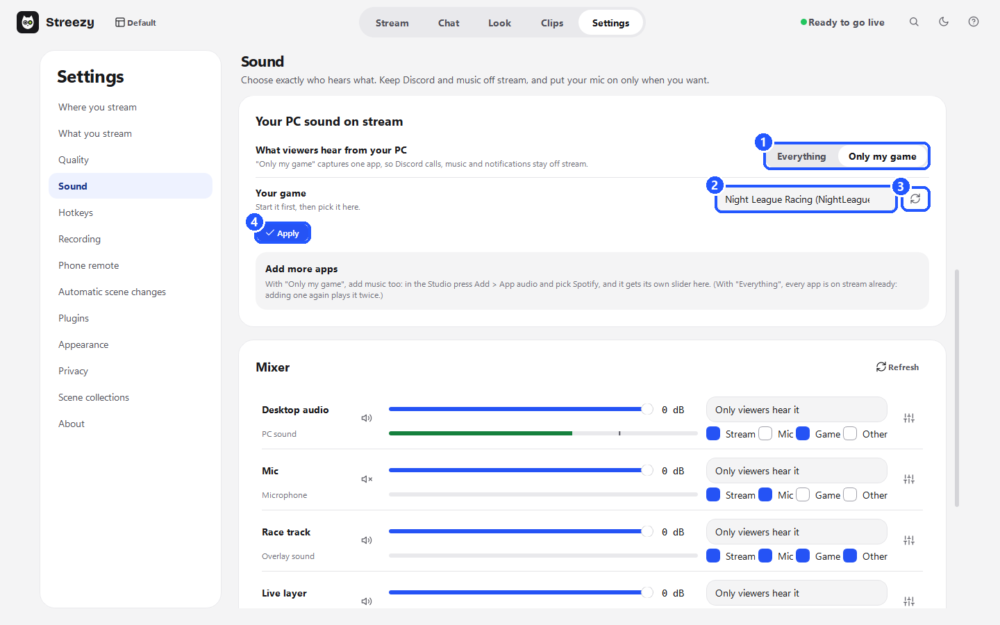

**Your PC sound on stream:**
1. **Everything** sends all PC sound. **Only my game** sends just one app, so Discord, music and notifications stay off stream.
2. With **Only my game**: start your game, then pick it here…
3. …(press the refresh button if it isn't listed yet)…
4. …and click **Apply**.

To add music as well, press **Add a game, camera or overlay > App audio** on the Stream page and pick Spotify. It gets its own slider.

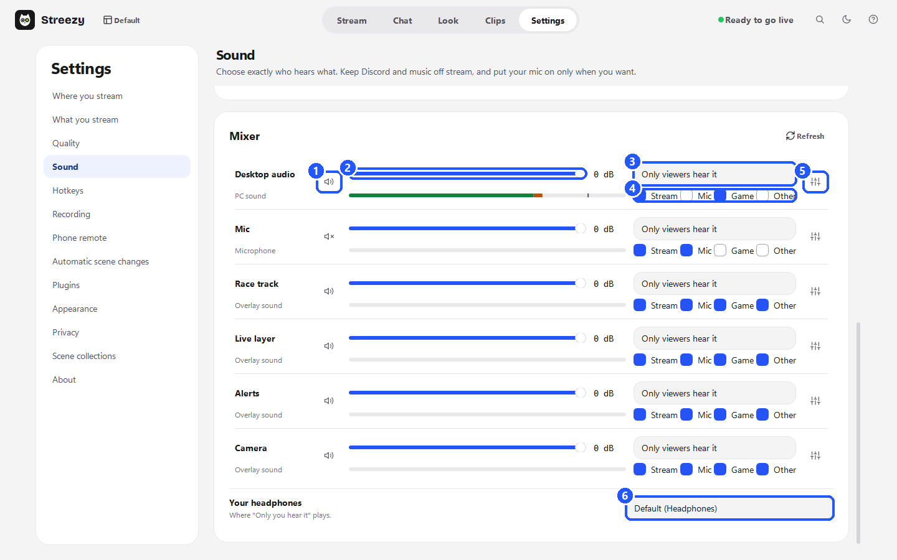

**The mixer** has one row per sound, including the sound of overlays and web pages:
1. **Mute on stream.**
2. **The volume slider**, in decibels.
3. **Who hears it:** **Only viewers hear it** (normal), **Only you hear it** (plays in your headphones and stays off stream), or **You and viewers**.
4. **Stream / Mic / Game / Other:** which recording tracks the sound goes to (see [section 23](#23-recording-and-clips)).
5. **Filters:** noise removal, compressor, EQ.
6. **Your headphones** chooses where "only you" sounds play.

> **Hearing something twice?** If PC sound is set to **Everything** and you also added an app with **App audio**, that app plays twice. Streezy warns you about this. Either switch PC sound to **Only my game**, or remove the extra source.

## 9. Overlays

Overlays are the graphics on top of your stream: the *Starting soon* countdown, a name tag, a goal bar, alerts, the on-screen chat. They all live on the **Look** page, which has a menu on the left with one part at a time on the right.

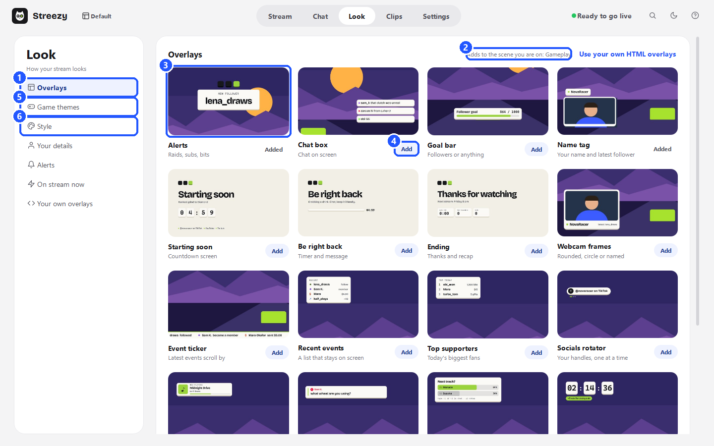

1. **Overlays** is the first part of the menu.
2. **Adds to the scene you are on** names the scene an overlay goes into. Switch scenes on the Stream page first if you want it somewhere else. **Added** under a tile means that scene already has it.
3. **Click a picture** to watch the overlay move in your web browser, with sample data.
4. **Add** puts it into the scene, sized for that canvas and put where it belongs: a webcam frame goes round your webcam, a name tag in the corner.
5. **Game themes** ([section 10](#10-game-themes)) has whole sets drawn for your game…
6. …and **Style** ([section 11](#11-style-25-looks)) changes how every overlay below looks.

All twenty built-in overlays:

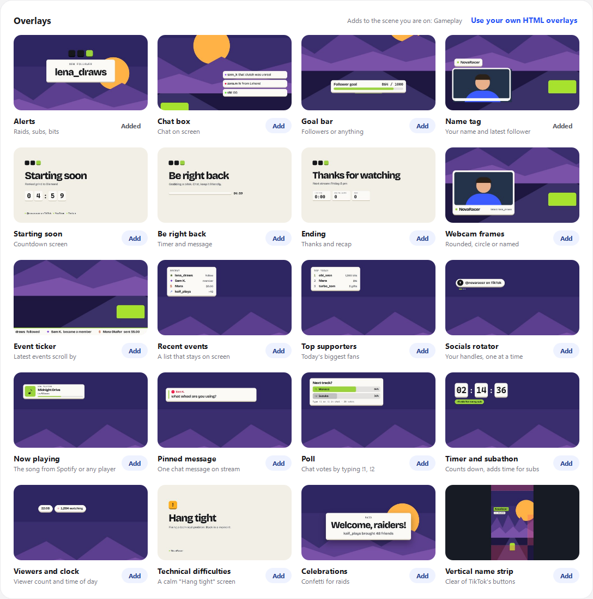

| Overlay | What it shows |
|---|---|
| **Alerts** | Pop-ups for raids, subs, bits, Super Chats and more |
| **Chat box** | Chat from every platform, on screen |
| **Goal bar** | A goal, for example followers |
| **Name tag** | Your name and latest follower |
| **Starting soon** | A countdown, your stream title and socials |
| **Be right back** | A timer and your message |
| **Ending** | Thanks and a recap of the stream |
| **Webcam frames** | Framed with your name, rounded or a circle, around your webcam |
| **Event ticker** | Latest events scrolling along the bottom |
| **Recent events** | A list of the latest events that stays on screen |
| **Top supporters** | Today's biggest fans |
| **Socials rotator** | Your handles, one at a time |
| **Now playing** | The song from Spotify or any music player |
| **Pinned message** | One chat message on stream ([section 14](#14-on-stream-now-poll-timer-pinned-message)) |
| **Poll** | Chat votes by typing !1, !2… |
| **Timer and subathon** | A countdown that can add time for each sub |
| **Viewers and clock** | Viewer count and the time of day |
| **Technical difficulties** | A calm "Hang tight" screen |
| **Celebrations** | Confetti for raids |
| **Vertical name strip** | Your name, kept clear of TikTok's buttons |

Overlays update straight away, even while you are live. You can also add them from **Add a game, camera or overlay > Streezy overlays** on the Stream page.

Here are some of them at work in one scene, a subathon timer, now playing, a poll and a pinned message:

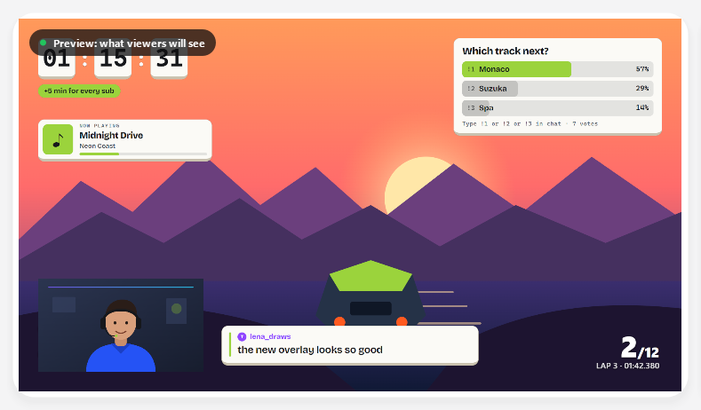

and the socials rotator, viewers and clock, recent events, a framed webcam and the event ticker:

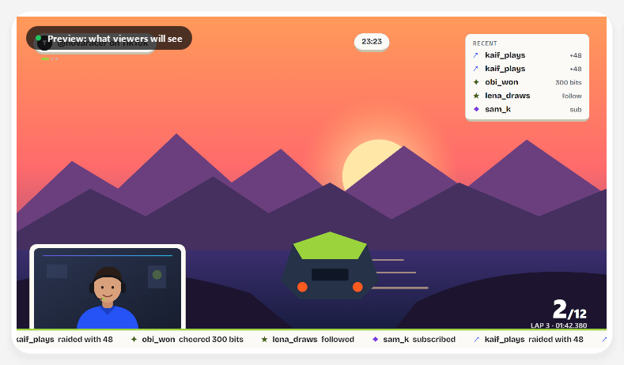

## 10. Game themes

A **game theme** is a set of five overlays drawn for the kind of game you play: **Starting soon**, **Be right back**, **Ending**, a **webcam frame** and **alerts**. There are 26, from tactical shooters to cozy farming games. The art is Streezy's own: no game's logo, characters or artwork are used.

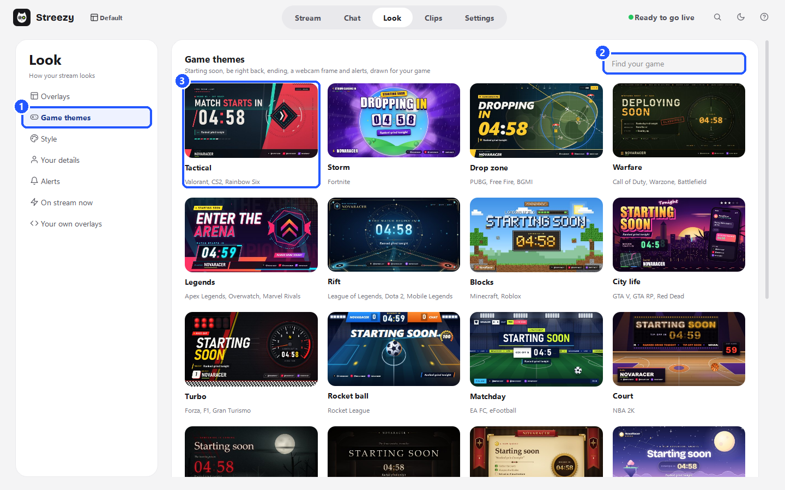

1. Open **Look > Game themes**.
2. **Find your game:** type its name.
3. **Click a theme** to see its five pieces.

The search understands the names people really type, short or long: *valorant*, *cs2*, *fortnite*, *pubg*, *bgmi*, *free fire*, *cod*, *warzone*, *apex*, *lol*, *dota*, *minecraft*, *roblox*, *gta*, *gta 6*, *gta online*, *rdr2*, *f1*, *forza*, *rocket league*, *fifa*, *fc 25*, *nba 2k*, *dbd*, *phasmo*, *elden ring*, *wow*, *genshin*, *tekken*, *among us*, *rust*, *stardew*, *sea of thieves*, *destiny*, *hearthstone* and many more. A kind of game works too: *shooter*, *racing*, *horror*, *football*.

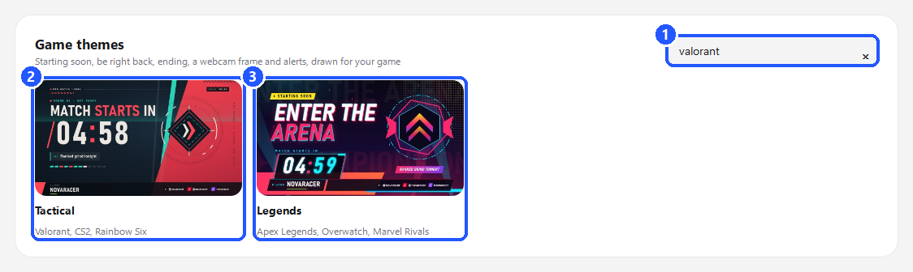

1. Typing **valorant**…
2. …finds **Tactical**, made for Valorant, CS2 and Rainbow Six…
3. …and **Legends**, the hero-arena theme that suits it too.

| Theme | Made for |
|---|---|
| Tactical | Valorant, CS2, Rainbow Six |
| Storm | Fortnite |
| Drop zone | PUBG, Free Fire, BGMI |
| Warfare | Call of Duty, Warzone, Battlefield |
| Legends | Apex Legends, Overwatch, Marvel Rivals |
| Rift | League of Legends, Dota 2, Mobile Legends |
| Blocks | Minecraft, Roblox |
| Neon coast | GTA 6 |
| Heist | GTA 5, GTA Online |
| City life | GTA RP, GTA V, Red Dead |
| Turbo | Forza, F1, Gran Turismo |
| Rocket ball | Rocket League |
| Matchday | EA FC, eFootball |
| Court | NBA 2K |
| Nightmare | Dead by Daylight, Phasmophobia, Resident Evil |
| Souls | Elden Ring, Dark Souls, Lies of P |
| Realm | World of Warcraft, Final Fantasy XIV, Diablo |
| Anime adventure | Genshin Impact, Honkai: Star Rail, Wuthering Waves |
| Fight night | Street Fighter, Tekken, Mortal Kombat |
| Party | Among Us, Fall Guys, Party Animals |
| Survival | Rust, ARK, DayZ |
| Cozy | Stardew Valley, Animal Crossing, The Sims |
| High seas | Sea of Thieves, Skull and Bones |
| Deep space | Destiny 2, Starfield, No Man's Sky |
| Cards | Hearthstone, Marvel Snap, Pokemon TCG |
| Arcade | Retro and pixel games |

### A theme's five pieces

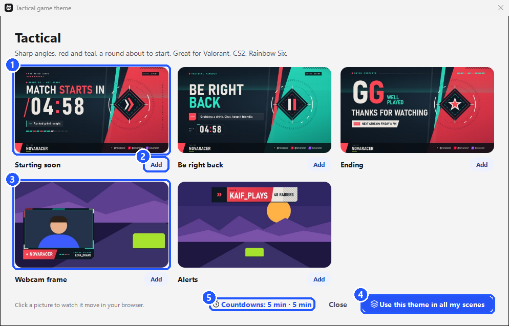

1. **Click a picture** to watch that piece move in your web browser, with a countdown and sample alerts.
2. **Add** puts one piece into the scene you are on. If that scene already has a screen or alerts of the same kind, the older one is hidden (not deleted), so two never sit on top of each other.
3. The **webcam frame** goes round your webcam, wherever it is in the scene.
   Once a piece is in the scene, its button turns green and reads **✓ Added**; pieces you already use in other scenes read **✓ In use**.
4. **Use this theme in all my scenes** does the whole job at once. First it lists each scene and what it will get, and nothing changes until you press **Use theme**:
   - **Starting soon**, **Be right back** and **Ending** go into the scenes with those names (Streezy also understands *intro*, *brb*, *break*, *outro* and the like),
   - the **alerts** go into every other scene,
   - the **webcam frame** goes round the camera in every scene that has one,
   - and the older screens, alerts and frames in those scenes are hidden, not deleted. Switch them back on under **In this scene** if you change your mind.

   Afterwards the button reads **✓ Using this theme in 5 scenes** (or however many you have).
5. **Countdowns** at the bottom shows how long Starting soon and Be right back count down. Click it to change them ([section 12](#12-your-details)).

The theme's names and colours follow **Your details** ([section 12](#12-your-details)), like every overlay.

> The full-screen pieces are rich animated pictures. To keep your PC free for the game, a theme's Starting soon, Be right back and Ending screens rest while their scene is off air, and start again the moment you switch to it. Alerts and the webcam frame keep running, because they show while you play.

## 11. Style: 25 looks

**Look > Style** decides how every built-in overlay looks: alerts, chat, goal, screens and the rest. Pick one and the overlays already in your scenes change at once. (Game themes have their own art and are not changed by Style.)

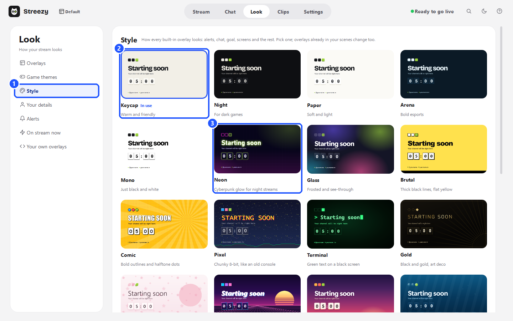

1. Open **Look > Style**.
2. **In use** marks the look you have now, here **Keycap**.
3. Click another to switch, for example **Neon**.

All 25 looks, each showing its *Starting soon* screen:

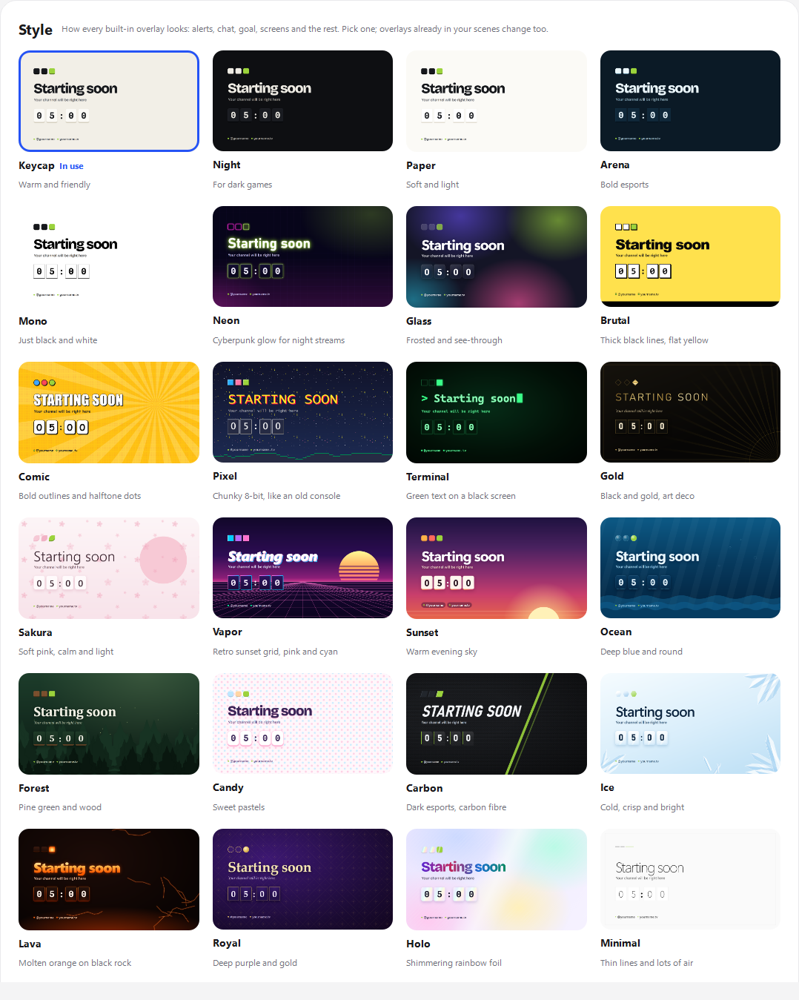

| Look | In a few words |
|---|---|
| Keycap | Warm and friendly, the Streezy look |
| Night | For dark games |
| Paper | Soft and light |
| Arena | Bold esports |
| Mono | Just black and white |
| Neon | Cyberpunk glow for night streams |
| Glass | Frosted and see-through |
| Brutal | Thick black lines, flat yellow |
| Comic | Bold outlines and halftone dots |
| Pixel | Chunky 8-bit, like an old console |
| Terminal | Green text on a black screen |
| Gold | Black and gold, art deco |
| Sakura | Soft pink, calm and light |
| Vapor | Retro sunset grid, pink and cyan |
| Sunset | Warm evening sky |
| Ocean | Deep blue and round |
| Forest | Pine green and wood |
| Candy | Sweet pastels |
| Carbon | Dark esports, carbon fibre |
| Ice | Cold, crisp and bright |
| Lava | Molten orange on black rock |
| Royal | Deep purple and gold |
| Holo | Shimmering rainbow foil |
| Minimal | Thin lines and lots of air |
| Retro | Seventies stripes in brown and orange |

Most looks use the colour you pick in **Your details**. A few keep their own on purpose (Mono, Terminal, Gold, Vapor, Lava and Royal).

## 12. Your details

Fill these in once and every overlay and game theme uses them. Open **Look > Your details**.

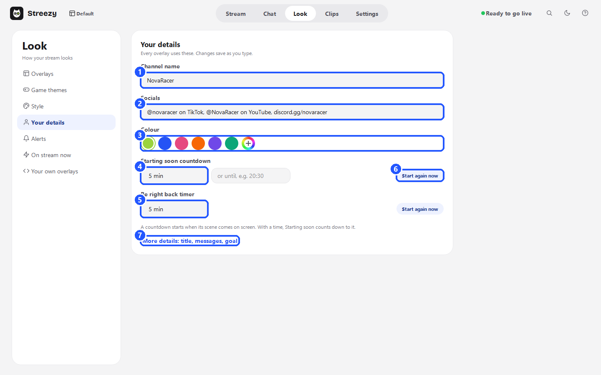

1. **Channel name:** shown on your screens and name tag.
2. **Socials:** your handles, separated by commas, for example `@you on TikTok, discord.gg/you`.
3. **Colour:** the accent colour of your overlays. The last circle lets you pick any colour.
4. **Starting soon countdown:** how many minutes it counts down, or a time to count down to, such as *20:30*.
5. **Be right back timer:** how many minutes it counts down.
6. **Start again now** restarts that countdown on every screen showing it, even while you are live.
7. **More details** opens the rest. **Fewer details** closes them again.
   - **Stream title:** what today's stream is about. **Go live** asks for it too.
   - **Be right back message.**
   - **Next stream:** shown on the Ending screen, for example "Next stream: Friday 8 pm".
   - **Technical difficulties message.**
   - **Goal:** a label and numbers for the goal bar, for example *Follower goal 864 of 1000*.

Changes save as you type, and overlays update straight away, even while you are live.

> **Countdowns** work on every Starting soon and Be right back screen: the built-in looks and all the game themes. A countdown starts again each time its scene comes on screen. You can also right-click a countdown in the Stream page preview for **Countdown length…** and **Start the countdown again**.

## 13. Alerts

Alerts are the pop-ups that thank viewers on screen. Open **Look > Alerts**.

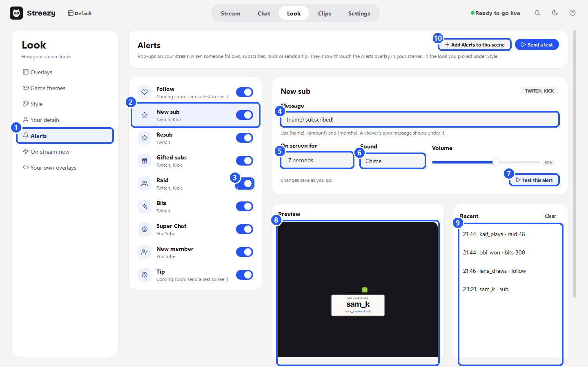

1. Open **Look > Alerts**.
2. **Click a kind of alert** in the list to change it, here **New sub**.
3. **The switch** on each row turns that kind on or off.
4. **Message:** use `{name}`, `{amount}` and `{months}`, which are filled in for you. A viewer's own message shows under it.
5. **On screen for:** how many seconds.
6. **Sound** (Click, Chime, Coin, Fanfare or none) and **Volume** beside it. For some kinds you can also tick **Read the viewer's message aloud**.
7. **Test this alert** shows it on your stream and in the preview. Changes save as you go.
8. **Preview** shows the alert in the look you picked.
9. **Recent** lists the latest alerts. Double-click one to show it again; **Clear** empties the list.
10. **Add Alerts to this scene** puts the Alerts overlay in the scene you are on. The setup already did this for your main scenes. **Send a test** next to it sends a test of each kind in turn.

| Alert | Comes from |
|---|---|
| New sub, Gifted subs, Raid | Twitch and Kick |
| Resub, Bits | Twitch |
| Super Chat, New member | YouTube |
| Follow, Tip | Coming in a later update. **Test this alert** already works. |

Alerts read events from your chat connection, so add your channels in **Chat** ([section 16](#16-chat)).

## 14. On stream now: poll, timer, pinned message

**Look > On stream now** runs the overlays that change during a stream. Add the **Poll**, **Timer and subathon** and **Pinned message** overlays to a scene first (from **Look > Overlays**).

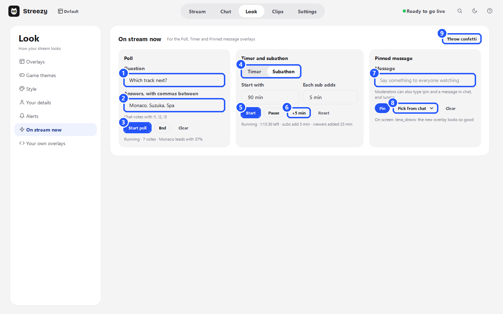

**Poll**
1. Type the **question**…
2. …and the **answers**, with commas between.
3. **Start poll.** Chat votes by typing `!1`, `!2`, `!3`; the line below shows the votes and who leads. **End** stops it, **Clear** takes it off screen.

**Timer and subathon**

4. **Timer** counts down. **Subathon** counts down too, and each sub adds the time you set under **Each sub adds**.
5. **Start** (then **Pause** and **Reset**).
6. **+5 min** adds five minutes by hand.

**Pinned message**

7. Type a **message** to everyone watching, then press **Pin**…
8. …or **Pick from chat** to pin something a viewer said. Moderators can also type `!pin` and a message in chat, and `!unpin`.

9. **Throw confetti** fills the screen with confetti through the Celebrations overlay.

## 15. Your own HTML overlays

You can use any folder of HTML overlays: ones made for OBS, ones you bought from a designer, or ones made for your channel. Open **Look > Your own overlays**.

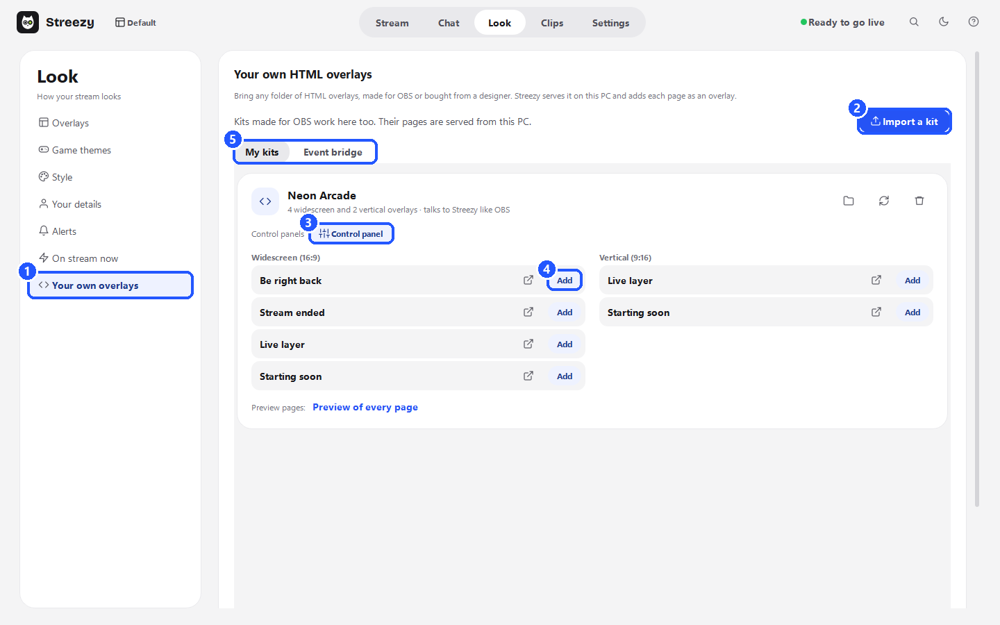

1. Open **Look > Your own overlays**.
2. **Import a kit** and choose **A folder** or **A .zip file**. Streezy serves the kit from your PC and lists each HTML page as an overlay, in a **Widescreen (16:9)** column and a **Vertical (9:16)** column.
3. Pages named *control*, *dock*, *panel* or *dashboard* become **control panels**, which open in a small window inside Streezy.
4. **Add** puts a page into the scene you are on. The arrow next to it opens the page in your browser. The buttons at the top of the kit's card open its folder, reload its pages after you edit them, or remove it.
5. **My kits** lists your kits; **Event bridge** sends Streezy's events (subs, raids and so on) to kits in the format each kit expects.

Many kits made for OBS talk to OBS's remote port. Streezy provides the same port ([section 27](#27-stream-deck-and-obs-tools)), so they work here too.

You can also add any web address or HTML file yourself with **Add a game, camera or overlay > Web page**.

## 16. Chat

Streezy shows Twitch, YouTube and Kick chat in one list. **Reading chat needs no sign-in.** Open **Chat** at the top.

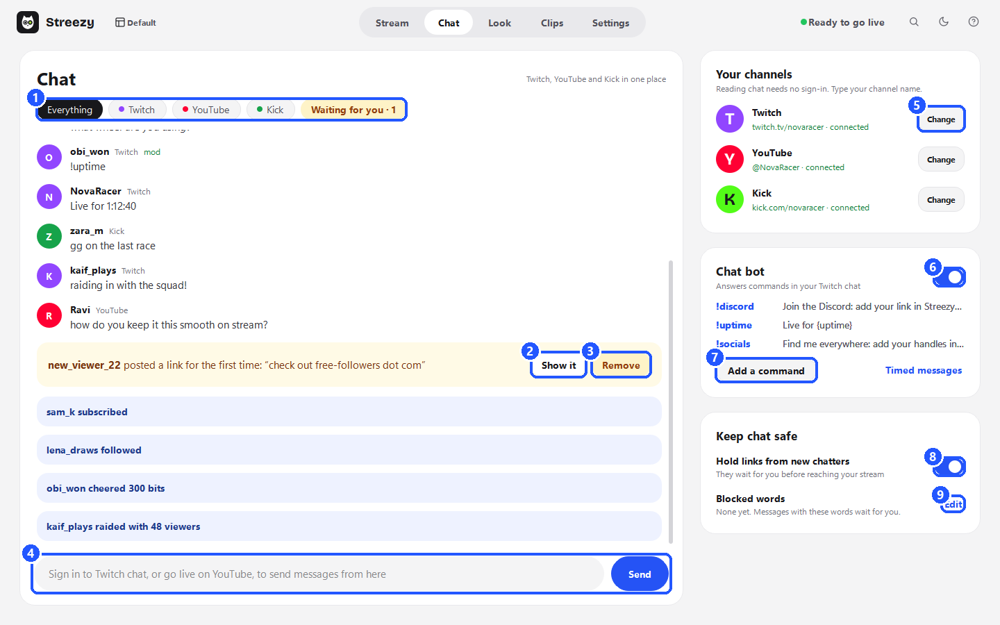

1. **Everything / Twitch / YouTube / Kick** shows chat from all platforms or one. **Waiting for you** shows the messages held for you (see Safety below).
2. A held message waits in yellow. **Show it** puts it in chat and on your on-screen chat box…
3. …and **Remove** drops it.
4. **Type here to send.** If you signed in with YouTube ([section 17](#17-add-where-you-stream)), you can write while you are live on YouTube. For Twitch, add your login under **Change** first.
5. **Your channels:** **Change** sets the channel for each platform.
6. **Chat bot:** the switch turns it on. It answers commands such as `!discord`, `!uptime` and `!socials` in Twitch chat, as you.
7. **Add a command** opens the bot's settings.
8. **Hold links from new chatters** (on by default): links from first-time Twitch chatters wait for you before they reach your stream.
9. **Blocked words: Edit.** Messages with these words are held too, including look-alike spellings such as `fr33`.

Alerts, follows and raids also appear in the list, so you never miss one.

### Connect your channels

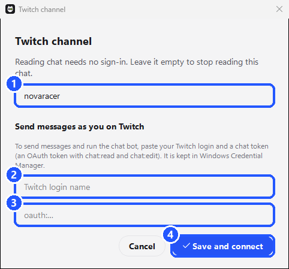

1. **The channel name**, the one in your link, for example `novaracer`. A full link works too. For YouTube use your @handle or any link to your channel; YouTube chat appears by itself once you are live. For Kick, the name in your Kick link.
2. To **send messages as you on Twitch** and run the bot, add your **Twitch login name**…
3. …and a **chat token** (an OAuth token with chat:read and chat:edit). It is kept in Windows Credential Manager.
4. Click **Save and connect**. The card on the Chat page then says *connected*.

### The chat bot

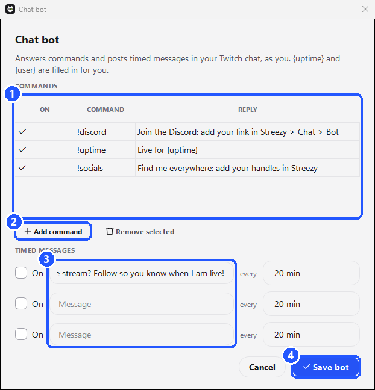

1. **Commands:** each has a trigger such as `!discord` and a reply. `{uptime}` and `{user}` are filled in for you. Untick one to pause it.
2. **Add command.**
3. **Timed messages** post something every few minutes while you are live, for example "New here? Follow so you know when I am live!"
4. Click **Save bot**.

The bot needs the Twitch login and token above.

---

# Part 3. Go live

## 17. Add where you stream

Open **Settings > Where you stream**. A **destination** is one place you stream to. You can stream to as many at once as your internet can carry.

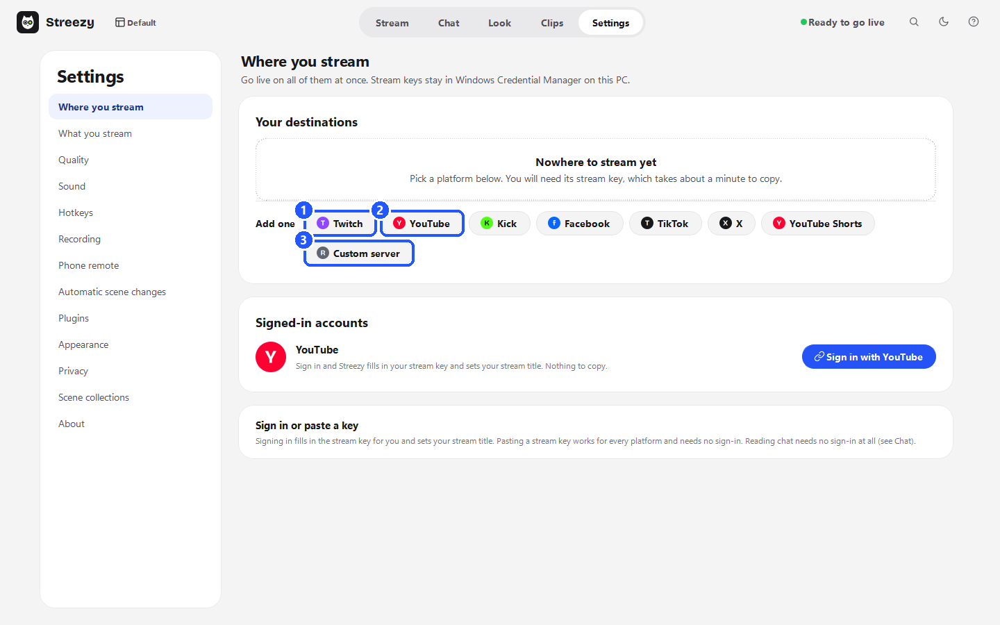

1. Click a platform, for example **Twitch**.
2. Or **YouTube**: you can also sign in instead of copying a key (see below).
3. **Custom server** works with anything that takes RTMP, RTMPS or SRT.

### Add a stream key

A **stream key** is like a password that lets an app stream to your channel. You copy it once from the platform's website.

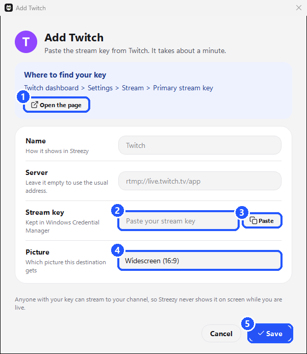

1. **Open the page** opens the right page on the platform's website. The box above it tells you exactly where the key is.
2. Copy the key there, then paste it into **Stream key**…
3. …or click **Paste**.
4. **Picture:** leave **Widescreen (16:9)**, or choose **Vertical (9:16)** for Shorts, TikTok and Reels.
5. Click **Save**.

Leave **Server** empty; Streezy fills in the usual address. Only Custom server, TikTok and X need one, and you copy it from the same page as the key.

| Platform | Where to find the key |
|---|---|
| **Twitch** | Twitch dashboard > Settings > Stream > Primary stream key |
| **YouTube** | YouTube Studio > Go live > Stream > Stream key. Or sign in instead (below). |
| **Kick** | Kick dashboard > Settings > Stream URL & Key. Copy both. |
| **Facebook** | Facebook Live Producer > Streaming software > Stream key |
| **TikTok** | TikTok LIVE Center > Streaming software. Needs TikTok LIVE access, and the key changes each stream. |
| **X** | X Live Studio > Sources > RTMP. Needs X Premium. |
| **YouTube Shorts** | YouTube Studio > Go live > Stream. Create a second stream key for the vertical stream. |

> **Keep your keys secret.** Anyone with your key can stream to your channel. Streezy stores keys in Windows Credential Manager, never in a file, and never shows them on screen while you are live. If a key ever leaks, reset it on the platform's website and paste the new one into Streezy.

### Your destinations

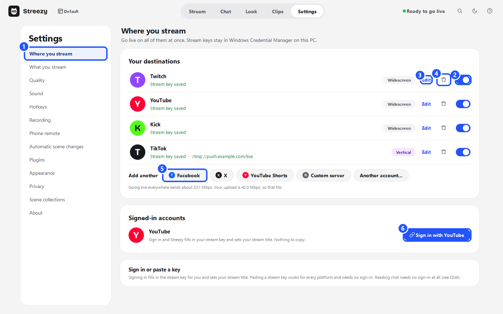

1. **Where you stream** is the first part of Settings.
2. **The switch** decides whether this destination is included when you go live.
3. **Edit** changes the key, name or picture (widescreen or vertical).
4. **The bin** removes the destination and its key from this PC.
5. **Add another:** Facebook, X, YouTube Shorts, a custom server or a second account on a platform you have.
6. **Sign in with YouTube** (see below).

Under the list, Streezy tells you how much upload going live everywhere needs, and whether your connection has room.

### Sign in with YouTube

Signing in means you never copy a YouTube key. Streezy fills it in, and sets your stream title, visibility and description when you go live.

1. Click **Sign in with YouTube**. Google's sign-in page opens in your browser.
2. Pick the Google account that owns your channel. Allow **Manage your YouTube account**.
3. The browser says *You are signed in*. Go back to Streezy.

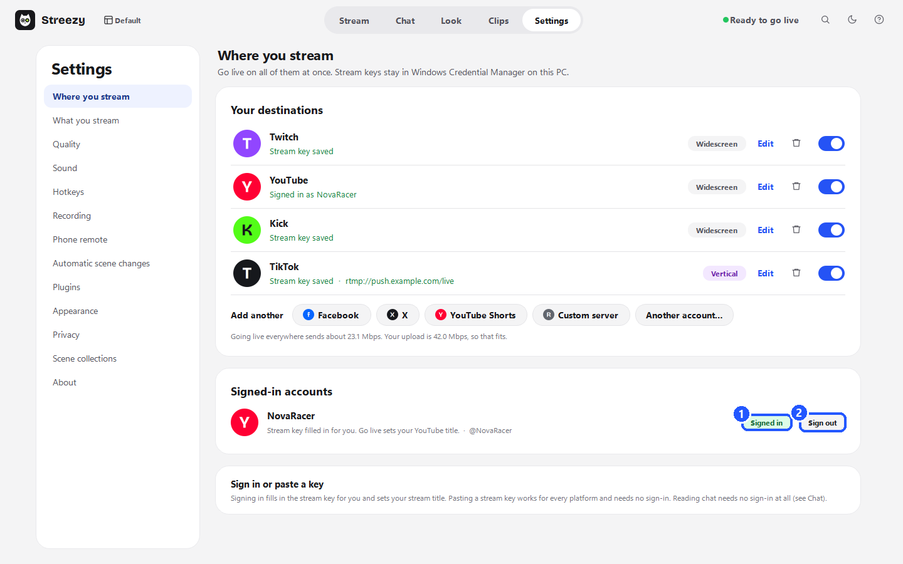

1. Your channel now appears under **Signed-in accounts** as **Signed in**, and your YouTube destination says *Signed in as* your channel.
2. **Sign out** whenever you like. That removes Streezy's access at Google. Your saved stream key stays, so you can still go live.

Your sign-in is kept on your PC in Windows Credential Manager. Nothing is sent to a zylio server. Live streaming must be turned on for your channel; the first time, YouTube can take up to 24 hours to allow it.

## 18. Pick your quality

Setup already chose a quality. To change it, open **Settings > Quality**.

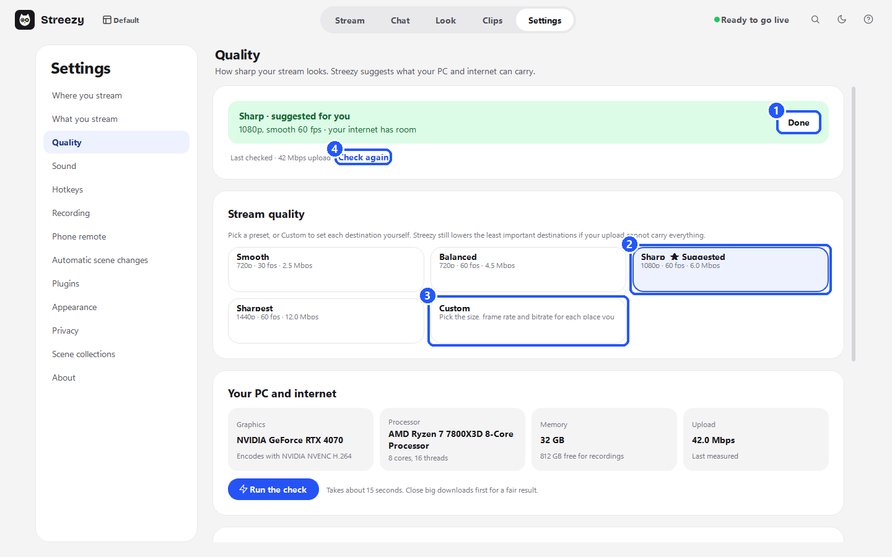

1. **Change** opens the presets (it says **Done** while they are open). The green line above says which preset you have and whether your internet has room.
2. **Pick a preset.** **★ Suggested** marks the one that fits.
3. **Custom** lets you choose size, frame rate, bitrate and codec for each destination.
4. **Check again** measures your upload again, which is worth doing if you change internet plans or move house.

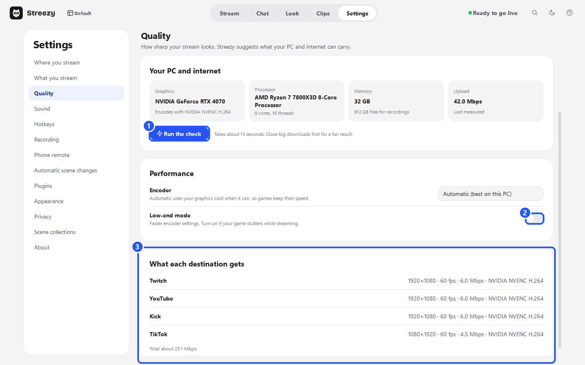

1. **Run the check** looks at your graphics card, processor, memory and upload.
2. **Low-end mode:** turn this on if your game stutters while streaming. **Encoder** above it is normally **Automatic (best on this PC)**.
3. **What each destination gets** shows exactly what each platform will receive.

If your upload can't carry every destination at full quality, Streezy lowers the least important ones to fit. They are marked *lowered to fit*.

## 19. Go live

Click **Go live** in the dock (or press **F9**). The little faces on the button show where you will go live.

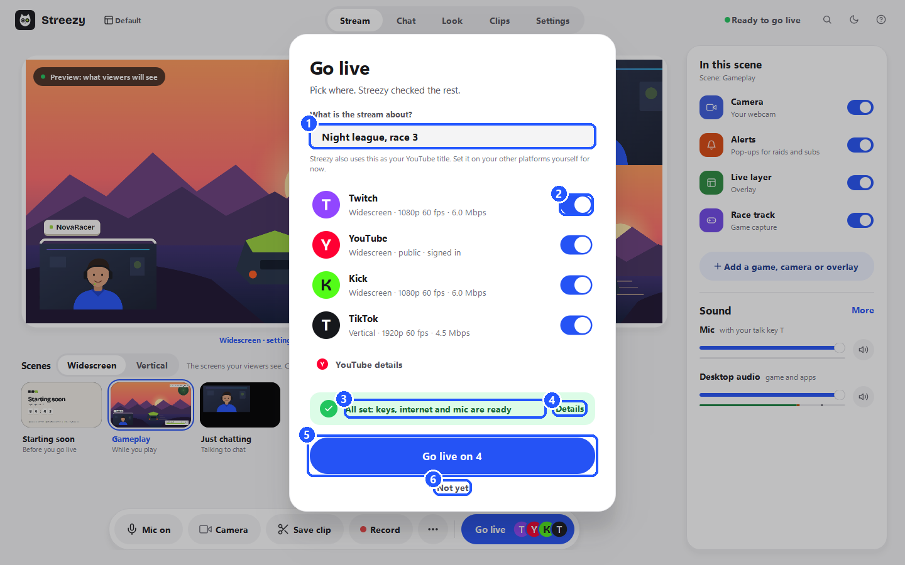

1. **What is the stream about?** Your title, shown on your overlays. If you signed in with YouTube, it also becomes your YouTube title.
2. **Switch each destination on or off** for this stream. Each line shows the picture, size, frame rate and upload it gets.
3. **The check line:** *All set: keys, internet and mic are ready*, or what needs a look.
4. **Details** shows what Streezy checked.
5. **Go live on 4** starts all of them together.
6. **Not yet** closes the card.

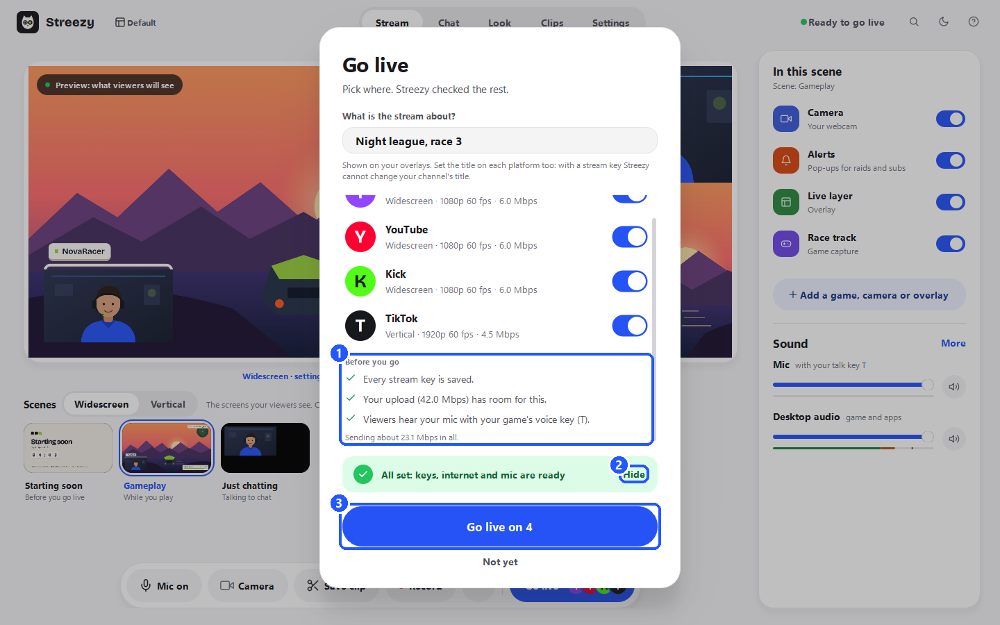

1. **Before you go:** Streezy checks stream keys, upload room, your mic, a game that isn't showing yet, sound that would play twice and two destinations sharing one key. A green tick is fine, an orange warning is worth reading, and a red cross must be fixed before you can go live. The last line says how much upload all of it needs.
2. **Hide** closes the details again.
3. **Go live.**

If you signed in with YouTube, the card has YouTube options too:

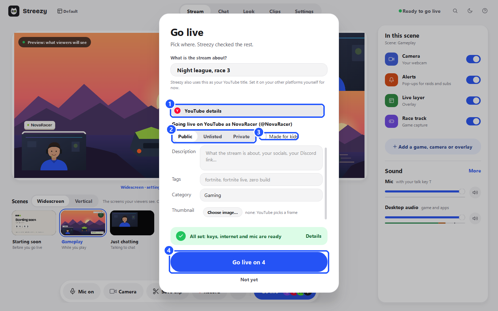

1. **YouTube details** opens them. The line under it says which channel you go live on.
2. **Public**, **Unlisted** or **Private.**
3. **Made for kids**, then a description, tags, a category and a thumbnail below.
4. **Go live.**

A few seconds later the button turns red and says **End stream**.

> **YouTube** usually takes 10 to 20 seconds before your stream appears on YouTube.

## 20. While you are live

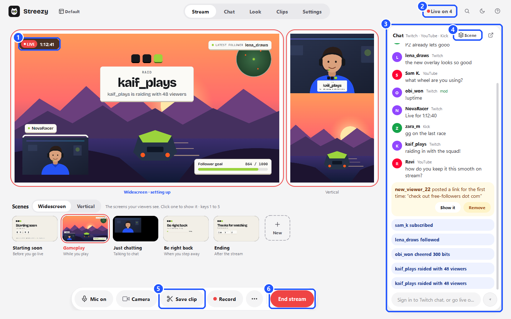

1. **LIVE** and the time live, on the preview. Both previews get a red ring.
2. **The status pill** says **Live on 4**. If something goes wrong, it names it, for example "Kick: reconnecting" or "Twitch: upload can't keep up". Click it for advice.
3. **Chat** from every platform takes the place of *In this scene*, with alerts and held messages in it.
4. **Scene** brings back *In this scene* and the sound; **Chat** there brings chat back.
5. **Save clip** saves the last moments.
6. **End stream** ends the stream on every platform.

### The dock

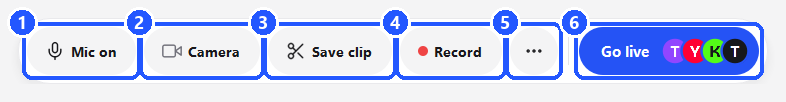

1. **Mic on:** mute your mic on stream. Discord still hears you. It turns red and says **Mic off** while muted.
2. **Camera:** hide or show your camera on stream, on both widescreen and vertical.
3. **Save clip** (**F10**): save the last moments as a clip. It shows when clips are on (they are by default).
4. **Record** (**F7**): start or stop recording to your PC.
5. **⋯** for more (below).
6. **Go live** (**F9**), with the faces of the platforms you will go live on. While live it is **End stream**.

The keys work even while your game is in front. On a narrow window, Mic, Camera and Clip shrink to icons.

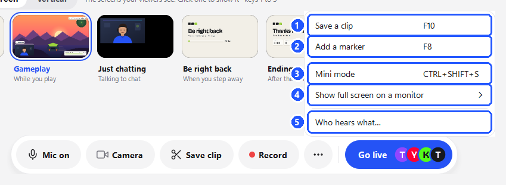

1. **Save a clip** (**F10**).
2. **Add a marker** (**F8**): note a moment to find later in the report and the recording.
3. **Mini mode** (**Ctrl+Shift+S**): a small controller over your game ([section 31](#31-command-palette-mini-mode-full-screen-and-virtual-camera)).
4. **Show full screen on a monitor:** your stream, widescreen or vertical, full screen on another monitor.
5. **Who hears what…** opens **Settings > Sound**.

Things you can do while live:
- **Switch scenes** by clicking them, with keys **1** to **9**, or **Ctrl+Shift+B** for Be right back.
- **Mute your mic** on stream with **Mic on** or **Ctrl+Shift+M**.
- **Change overlays, alerts and your details.** Changes show at once.
- **Run a poll, a timer or a pinned message** from **Look > On stream now**.
- **Use your phone** as a remote ([section 26](#26-the-phone-remote)).

**If your internet drops**, Streezy reconnects by itself and tells you when each platform is back. You don't need to do anything.

**If the video engine ever stops**, Streezy restarts it, reloads your scenes and reconnects your stream by itself, usually within seconds. A message tells you it is *Back on track*.

## 21. End the stream

Click **End stream** and confirm. With the hotkey, press **F9** twice within 3 seconds. On the phone remote, hold **Hold to end stream**.

If you set an **ending scene** in [Automatic scene changes](#25-automatic-scene-changes), Streezy shows it for a few seconds before stopping, so the stream doesn't just cut off. Press End again to stop straight away.

When the stream ends, Streezy opens its **report** in **Clips > Reports** ([section 24](#24-stream-reports)). If you went live with YouTube sign-in, the YouTube broadcast is ended too.

---

# Part 4. Widescreen and vertical

## 22. Stream vertical for Shorts, TikTok and Reels

Phones show video upright (9:16). Streezy can stream:
- **widescreen only:** the normal 16:9 picture,
- **vertical only:** just the upright picture, for example only TikTok or YouTube Shorts,
- **or both at once**, each with its own layout. For example, your game on Twitch and a phone-friendly layout on TikTok, live at the same moment.

### Choose what you stream

Open **Settings > What you stream**. In setup you get the same two switches.

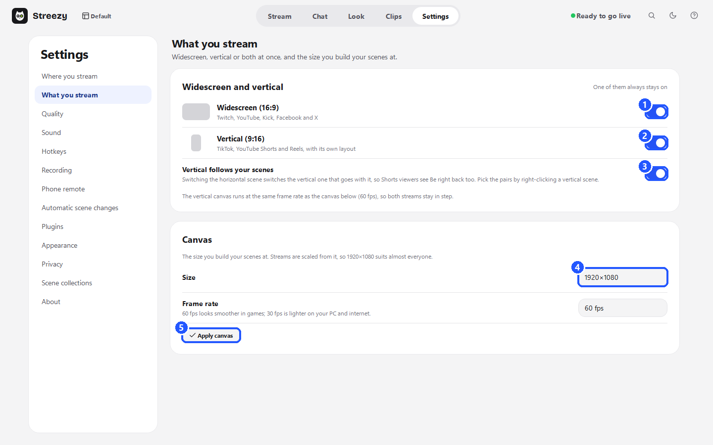

1. **Widescreen (16:9):** the picture for Twitch, YouTube, Kick, Facebook and X.
2. **Vertical (9:16):** the upright picture for TikTok, YouTube Shorts and Reels.
3. **Vertical follows your scenes** (only shown when both are on): when you switch your widescreen scene, the matching vertical scene switches too. Shorts viewers see *Be right back* when everyone else does.
4. **Size** of the canvas you build scenes on, with **Frame rate** below it. 1920×1080 at 60 fps suits almost everyone.
5. **Apply canvas** saves a change to the size or frame rate.

One of the two always stays on. If you turn off the last one, the other switches on. When vertical is turned on, Streezy gives each of your scenes a vertical version: scenes with a game get the game at the bottom and your webcam on top; other scenes are shown whole in the middle until you arrange them.

Adding a destination whose **Picture** is **Vertical (9:16)**, such as TikTok or YouTube Shorts, also turns vertical on.

### Both at once

1. **Widescreen / Vertical** next to *Scenes* chooses which stream you are setting up. The scene cards, *In this scene* and the overlays you add from the Look page all follow it.
2. **The vertical preview** shows what phone viewers see; its caption says **Vertical · setting up**. Arrange things in it the same way as in the widescreen preview.
3. Click the **Widescreen** caption (or the switch) to go back to the widescreen stream.
4. *In this scene* says **Vertical scene:** and the scene's name, so you always know which one you are changing.

To put something you already have onto the vertical canvas, right-click it and choose **Also show in Vertical**.

**Sound** is the same on both streams: one mic, one PC sound.

### Vertical only

With **Widescreen** off:
- The Stream page shows only your 9:16 preview and your vertical scenes. Build them the same way as widescreen ones.
- Overlays, game themes and alerts you add from the Look page go into your vertical scenes.
- New destinations start as **Vertical (9:16)**.
- In **Go live**, widescreen destinations say *horizontal is off* and sit the stream out, so only your vertical platforms go live.

### Pair vertical scenes

On the **Vertical** side, right-click a vertical scene and open **Switches with** (1). Pick the widescreen scene it goes with, or **Nothing, I switch it myself** (2).

### Stream it

Each destination's **Picture** setting decides which canvas it gets. TikTok and YouTube Shorts are vertical by default. In **Go live**, switch on both kinds of destination and they start together.

---

# Part 5. More tools

## 23. Recording and clips

### Recording

Press **Record** in the dock (or **F7**) to record to your PC; press it again to stop. You can record without going live. Recording settings are in **Settings > Recording**.

1. **Change** the folder recordings go to. By default it is `%USERPROFILE%\Videos\Streezy`. **Open** opens it.
2. **Record whenever I go live** keeps a full copy of every stream.

**Quality** is **Standard**, **High** or **Best**. Recordings are MP4 files that stay playable even if your PC crashes mid-recording.

**Separate audio tracks** records your mic, game and other sounds on their own tracks as well as the full mix, which is handy for editing.

### Clips

A clip saves **the last moments** of your stream (2 minutes by default) after something great happens. Open **Clips** at the top.

1. **The player:** click to watch.
2. **Show in folder**…
3. …**Rename**…
4. …or **Delete**, which moves it to the Recycle Bin.
5. **Keep the last 2 minutes ready** must be on for clips (it is by default).
6. **Clip length** sets how much is kept.
7. **Clips / Recordings / Reports** switch what the list shows.

Save a clip with **F10**, **Save clip** in the dock, mini mode or your phone. Clips go to the `Clips` folder inside your recordings folder.

1. **Recordings** lists whole streams and recordings…
2. …newest first. Click one…
3. …to watch it here, with the same buttons as clips.

**Markers** (**F8**) note a time during a stream or recording. They appear in the report, so you can find highlights later.

## 24. Stream reports

After every stream Streezy writes a short report. Open **Clips > Reports**.

1. **Reports** lists them…
2. …one per stream. Click one to read it.

It shows:
- how long you were live
- dropped frames
- chat messages, new followers, subs and raids
- a chart of what Streezy sent to each platform
- markers, who to thank, and what happened (for example a reconnect)
- **plain advice**, for example "Smooth stream: no dropped frames and no reconnects", or what to change next time

## 25. Automatic scene changes

Let Streezy switch scenes for you. Open **Settings > Automatic scene changes**.

1. **When a game comes to the front, switch scene.** Alt-tab into your game and the game scene goes on air. Add a rule per app (a browser for tutorials, Photoshop for art)…
2. …or press **Add the app in front in 5 s** and click into the game.
3. **When you step away, show Be right back.** After a few minutes without keyboard or mouse input while live, Streezy switches to Be right back, and switches back when you return. It never uses your camera for this.
4. **When the stream starts:** open on your Starting soon screen, then move on to your main scene after a few minutes.
5. Click **Save rules**.

Further down, **When I press End stream** shows your Ending scene for a few seconds before the stream stops.

## 26. The phone remote

Your phone can be a remote: a deck of big keys to switch scenes, mute, clip and go live, with your sound and chat beside them. Nothing to install. Open **Settings > Phone remote**.

1. **Phone remote** turns it on or off.
2. With your phone on the same Wi-Fi as your PC, **scan the code** with the phone's camera…
3. …and type the **4-digit PIN**.
4. **New PIN** signs every phone out.
5. **Or type this address** in the phone's browser, if it can't scan the code: `http://` your PC's address `:17887/remote`.

If the phone can't open the page, allow Streezy through Windows Firewall on private networks when Windows asks.

### Deck

1. **Hold to go live:** press and hold for a moment, so a tap in your pocket never starts or ends a stream. While live it says **Hold to end stream**, and the top shows LIVE, the time, the upload and how many platforms.
2. **Scene keys** with live pictures of each scene and their number. The one on air says **ON AIR** (or **LIVE**). Tap one to switch.
3. **Deck / Sound / Chat** at the bottom. A red badge on Chat counts new messages.

Scroll down for the controls:

1. **Mic:** green **Mic on**, red **Mic off**.
2. **Camera:** hide or show your webcam.
3. **Record.**
4. **Clip:** save the last moments.
5. **Marker.**
6. **BRB:** go to your Be right back scene; it turns amber and says **Back to it** to return to the scene you left.
7. **Test alert:** a different test each time (follow, sub, raid, bits, Super Chat).
8. **Confetti.**
9. **+5 min** on the timer or subathon.

### Sound and Chat

1. **Mute** each sound…
2. …or slide its volume.
3. **Sound** is the second tab.

1. **Chat** from every platform, as it comes in.
2. **Say something to chat** and send. It goes out the same way as from the Chat page (Twitch with your login, YouTube while you are live there).

## 27. Stream Deck and OBS tools

Streezy speaks the same remote language as OBS (obs-websocket 5). Stream Deck, Touch Portal, Streamer.bot, Bitfocus Companion and overlay kits made for OBS connect to it. The settings are further down **Settings > Phone remote**.

1. **Server:** your PC's address (or 127.0.0.1 on this PC).
2. **Port:** 4455, the same as OBS.
3. **Password:** **Show** or **Copy** it into the tool; **New password** makes another.
4. Click **Save** after a change.

> OBS Studio uses port 4455 too. If OBS is open with its WebSocket server on, close OBS or pick another port here, then click **Save**.

## 28. Plugins

Streezy runs on the OBS engine, so most OBS source and filter plugins work here too. Open **Settings > Plugins**.

1. **Add a plugin:** download the plugin for Windows (64-bit) from its page, then choose the .zip file or the unzipped folder. Only add plugins from places you trust.
2. **Copy from OBS Studio:** brings over the plugins you already use in OBS.

Then click **Restart the engine to apply changes** (not while live or recording). Each plugin has a switch to turn it off. Plugins that add OBS menus or docks don't work, because Streezy has its own window. A plugin that crashes only restarts the engine, never Streezy itself.

## 29. Scene collections and moving from OBS

A **scene collection** is a full set of scenes, for example one per game or show. Switch between them with the button next to the Streezy name at the top left. Manage them in **Settings > Scene collections**.

1. **New** makes a collection: empty, or with ready-made scenes for a kind of stream. You can also **Switch to it**, **Duplicate**, **Rename** or **Delete** one.
2. **Import from OBS Studio** brings your OBS scene collections across, with sources, filters and layouts. **Import a collection file** works with a `.json` file exported from OBS.

## 30. Hotkeys

Hotkeys work even while your game has focus, and the game still gets the key press. Change them in **Settings > Hotkeys**: click a key, press the new one, or press **Esc** to cancel. **Clear** turns one off.

| What | Default key |
|---|---|
| Go live and end stream (press twice within 3 s to end) | **F9** |
| Start or stop recording | **F7** |
| Save a clip | **F10** |
| Add a marker | **F8** |
| Mute mic on stream | **Ctrl+Shift+M** |
| Switch to Be right back | **Ctrl+Shift+B** |
| Mini mode | **Ctrl+Shift+S** |
| Switch to scene 1 to 9 (in Streezy, on the Stream page) | **1** to **9** |
| Command palette (in Streezy only) | **Ctrl+K** |
| Settings (in Streezy only) | **Ctrl+,** |

Mic keys are in **Settings > Sound** (**Open Sound** at the bottom of Hotkeys): push to talk (**V**), your game's voice key (**T**) and quick mute (**Ctrl+Alt+M**).

## 31. Command palette, mini mode, full screen and virtual camera

### Command palette

Press **Ctrl+K**, or click the search icon at the top, and type.

1. Type a scene name or a command, for example "scene", "mute", "add webcam" or "test alert"…
2. …then use the arrow keys and **Enter** to run one from the list.

### Mini mode

Mini mode (**Ctrl+Shift+S**, or **⋯ > Mini mode** in the dock) is a small window that floats over your game. It shows whether you are live, and has:
1. a **scene** picker,
2. **mute** for your mic (red while viewers can't hear you), with **clip** and **marker** beside it,
3. **record**,

plus your mic level and the latest chat message. Drag it anywhere.

### Full screen on a monitor

**⋯ > Show full screen on a monitor** in the dock (or right-click an empty part of the preview) shows your stream full screen on another monitor, widescreen or vertical. That is useful for a second screen or a capture setup. Press **Esc** on it to close it.

### Virtual camera

Streezy can appear as a webcam in Zoom, Google Meet or Discord. Press **Ctrl+K** and run **Start virtual camera**, then pick "OBS Virtual Camera" in the other app. **Stop virtual camera** turns it off.

## 32. Other settings

### Appearance

- **Theme:** Light or Dark. The moon icon in the top bar switches it too.
- **Text size:** Compact, Normal or Large.

Here is the Stream page in the dark theme:

### Privacy

1. **Streamer mode** (on by default) hides stream keys and other private details on screen, even partly. Keep it on while you stream.

**Check for updates** asks GitHub once at start-up whether a newer Streezy exists; nothing about you is sent. **Open logs folder** and **Open settings folder** are here too.

### About

1. **Check for updates.** You can also open zylio.net or the source code from here.

---

# Part 6. Help

## 33. The stream doctor

Click the status pill at the top (**Ready to go live**) or the **?** at the top right.

The doctor checks the things that most often cause dropped frames, lag or silence:
- the video engine
- frames
- the encoder
- your upload
- your mic
- game capture
- disk space
- chat sign-ins
- sound playing twice
- plugins

Each problem comes with a button that fixes it or takes you to the right place. **Check again** runs the checks again.

1. **Copy a support report** copies a summary to send when asking for help. It never contains stream keys or passwords.

## 34. If something goes wrong

| Problem | What to do |
|---|---|
| **The game shows black or nothing** | Start the game first; the source says *waiting for the game* until then. Run the game in borderless or full screen, or use **Window** capture instead. Some anti-cheat games block capture. |
| **Parts of the preview are black** | That's what viewers see too: nothing is there in the scene. Right-click the game or camera and choose **Size and position > Fill the screen**, or add a picture or colour behind. |
| **A screen capture shows the wrong monitor** | Double-click it and pick the monitor. A screen capture with no monitor picked shows your main screen. |
| **Viewers can't hear me** | Check the mic mode in **Settings > Sound**. With **Push to talk** or **With my game's talk key**, viewers only hear you while you hold the key. Check **Mic on** in the dock isn't red. |
| **Viewers hear my Discord** | In **Settings > Sound** set PC sound to **Only my game**, and the mic to **With my game's talk key** or **Push to talk**. |
| **Something is heard twice** | PC sound is set to **Everything** and you also added that app. Set PC sound to **Only my game**, or remove the extra source. |
| **The stream stutters or drops frames** | Choose a lighter preset in **Settings > Quality**, run the check again, or switch off a destination. If the game itself stutters, turn on **Low-end mode**. |
| **The PC works hard with a game theme** | It shouldn't: a theme's Starting soon, Be right back and Ending screens rest while their scene is off air. If you added the same screen to the scene you play in, hide it there. |
| **A game theme's screen is still, not moving** | Its scene is off air, so it is resting. It starts the moment you switch to that scene. |
| **"No stream key saved"** | Add the key in **Settings > Where you stream** (**Edit**). |
| **"Use the same stream key"** | Two destinations have the same key. Each needs its own. For YouTube plus Shorts, make a second key in YouTube Studio. |
| **YouTube shows nothing** | Wait 10 to 20 seconds after going live. Check live streaming is turned on for your channel in YouTube Studio. If you signed in, try signing out and in again in **Settings > Where you stream**. |
| **YouTube chat doesn't show** | It appears once you are live on YouTube. Check your channel under **Chat > Your channels**. |
| **Overlays are blank** | Another program may be using Streezy's overlay port. The stream doctor says so; close that program and restart Streezy. |
| **An overlay went into the wrong scene** | Overlays go into the scene you are on (and the stream you are setting up, widescreen or vertical). Switch scene first, or right-click the overlay and **Remove** it. |
| **The phone remote won't open** | The phone must be on the same Wi-Fi. Allow Streezy through Windows Firewall on private networks. Type the address from **Settings > Phone remote** if the code doesn't scan. |
| **The phone says "That PIN is not right"** | Type the PIN shown in **Settings > Phone remote**. After **New PIN**, every phone signs in again. |
| **Stream Deck can't connect** | OBS may be open on port 4455. Close OBS or change the port in **Settings > Phone remote**. |
| **The engine keeps restarting** | Open the stream doctor. A plugin you added may be crashing it; turn it off in **Settings > Plugins**. |

### When Streezy restarts things by itself

- **The video engine runs separately from the window.** If a plugin, capture or overlay crashes it, Streezy restarts it within seconds, brings back your scenes, and reconnects your stream and recording. A message explains what happened.
- **Safe mode:** if the engine stops more than once, Streezy pauses the plugins you added. The doctor offers **Leave safe mode** when you are ready.
- **Overlays without the graphics card:** if a web overlay crashed the graphics part of the engine, overlays switch to drawing on the processor. The doctor offers **Use the graphics card again**.
- **Safe start:** if Streezy didn't close properly last time, it asks whether to **Start normally** or **Safe start** (without your scenes and plugins). Your scenes stay saved either way. Load them later from the stream doctor with **Load my scenes**.

## 35. Updating and uninstalling

- **Updating:** when a new version is out, Streezy shows *Update available* a few seconds after it starts. Click **Install now**. Streezy checks the download is genuine, installs it, and opens again. If you are live, it waits until you finish. You can also check in **Settings > About**. Your settings, scenes, overlays and recordings stay as they are.
- **Uninstalling:** use **Windows Settings > Apps > Streezy > Uninstall**. Your settings, scenes and recordings are kept, in case you come back. Delete `%APPDATA%\Streezy` and `%USERPROFILE%\Videos\Streezy` yourself if you want them gone.

## 36. Privacy and where your files are

- **No account, no analytics, no tracking.** Streezy connects only to what you set up: the platforms you stream to, the chats you add, Google if you sign in with YouTube, Cloudflare's speed test when you run the check, and GitHub once at start-up to look for an update.
- **Stream keys and sign-ins** are kept in Windows Credential Manager on your PC, never in a file, and never sent to zylio.
- **Overlays and game themes** are served from your own PC and only answer it. The **phone remote** needs your PIN, and the **remote port** for Stream Deck and OBS tools needs its password.
- **Reading chat** connects straight to Twitch, YouTube and Kick, the way their websites do.

| What | Where |
|---|---|
| Settings, scenes, reports, logs, plugins, overlay kits | `%APPDATA%\Streezy` |
| Recordings | `%USERPROFILE%\Videos\Streezy` |
| Clips | `%USERPROFILE%\Videos\Streezy\Clips` |
| The app itself | `C:\Program Files\Streezy` |

Read the full privacy policy at [zylio.net/privacy](https://zylio.net/privacy#streezy).

## 37. Words you will see

| Word | Meaning |
|---|---|
| **Scene** | One screen layout, for example *Gameplay* or *Be right back*. |
| **Source** | One thing inside a scene: your game, camera, an image, an overlay. |
| **Overlay** | Graphics on top of your stream, such as a name tag, alerts or a countdown. |
| **Look** | One of the 25 styles for Streezy's built-in overlays. |
| **Game theme** | A set of five overlays drawn for a kind of game. |
| **Canvas** | The picture you build scenes on. Widescreen is 16:9; vertical is 9:16. |
| **Destination** | A place you stream to, such as Twitch, YouTube or Kick. |
| **Stream key** | A secret code from the platform that lets an app stream to your channel. |
| **Bitrate (Mbps)** | How much data your stream sends each second. Higher looks sharper but needs more upload. |
| **Upload speed** | How fast your internet can send data. Streaming depends on upload, not download. |
| **Encoder** | The part that compresses your video. A graphics-card encoder (NVIDIA, AMD, Intel) leaves your processor free. |
| **Dropped frames** | Frames that didn't reach the platform because the upload couldn't keep up. |
| **Push to talk** | Viewers hear your mic only while you hold a key. |
| **Clip** | A short video of the last moments, saved with one key. |
| **Marker** | A note of a moment, to find it later in the recording. |
| **Deck** | The phone remote's page of big keys. |

## 38. Get help

- **Email:** [support@zylio.net](mailto:support@zylio.net). Paste the **support report** from the stream doctor so we can help faster.
- **Website:** [zylio.net/software/streezy](https://zylio.net/software/streezy)
- **Downloads and what's new:** [the releases page](https://github.com/faisalrasheed442/streezy-releases/releases)

Streezy is free and stays free. It's made by one person at zylio, on top of the engine the OBS Studio project has spent more than ten years building. Thank you to everyone who works on OBS.
